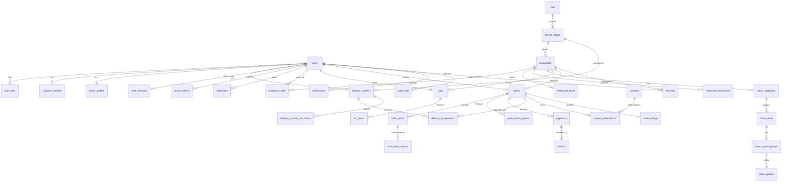

# Hungerly — Database Schema

> Status: **Draft for review** (Phase 0). This is the logical design; physical DDL will be produced as Alembic migrations in later phases and must stay consistent with this document. Changes to this file go through a PR.

Related: [BLUEPRINT.md](BLUEPRINT.md) · [API_BLUEPRINT.md](API_BLUEPRINT.md) · [ADR-003](decisions/ADR-003-database.md)

---

## 1. Conventions

| Topic | Convention | Reason |
|---|---|---|
| Engine | PostgreSQL 16+ with the **PostGIS** extension, plus `citext` and `pg_trgm` | Relational integrity for money/orders; geospatial queries for "restaurants near me" and zones; trigram search for MVP search |
| Primary keys | `uuid`, generated application-side as **UUIDv7** | Time-ordered (good B-tree locality), not guessable/enumerable, safe to expose in URLs, generatable offline by clients if ever needed |
| Human-facing IDs | Separate columns where needed (e.g. `orders.order_number`) | Support staff and customers need short readable references; never reuse the PK for that |
| Naming | `snake_case`, plural table names, FK columns named `<entity>_id` | Consistency |
| Timestamps | `timestamptz`, stored in UTC; every table has `created_at`, mutable tables also `updated_at` | Avoid timezone bugs; display in the city's timezone |
| Money | `bigint` in **minor units** (paise) with suffix `_minor`, plus `currency char(3)` on financial records (MVP: always `INR`) | Never use floating point for money |
| Percentages | `integer` basis points with suffix `_bps` (1% = 100 bps) | Exact arithmetic |
| Enumerations | `text` columns with `CHECK (col IN (...))` constraints, mirrored by Python enums | Adding a value is a simple migration, unlike altering native PG enums inside transactions |
| Soft delete | Only where history must survive (`addresses`, `menu_items`, `menu_categories`, `restaurants` via status). Uses `deleted_at timestamptz NULL` | Orders reference historical data; everything else is hard-deleted |
| Snapshots | Orders copy names/prices/addresses at placement time | An order must never change when a menu or address changes later |
| Geography | `geography(Point, 4326)` for points, `geography(MultiPolygon, 4326)` for zones; GiST indexes | Distance in metres, correct on a sphere |
| Optimistic locking | `version integer` on `orders` and `delivery_assignments` | Concurrent status updates (restaurant, rider, admin, webhooks) must not silently overwrite each other |
| JSON | `jsonb` only for genuinely unstructured data (webhook payloads, audit diffs, notification payloads) | Keep queryable business data in columns |

All `CHECK`, `UNIQUE`, and `FOREIGN KEY` constraints are enforced in the database, not only in application code.

---

## 2. Entity overview

The requested starting list was reviewed and normalized. Changes versus the initial list:

| Initial suggestion | Decision | Why |
|---|---|---|
| `users` + `customers` + `admin_users` | `users` (identity) + `user_roles` + role profiles `customer_profiles`, `admin_profiles` | One person can hold several roles (a restaurant owner also orders food). Identity, credentials and sessions live in one place; role-specific data lives in profiles |
| `reviews` + `ratings` | Merged into **`order_ratings`** (one row per delivered order) | Ratings are only allowed for real, delivered orders; one table avoids two sources of truth. Restaurant and delivery ratings are separate columns |
| `restaurant_documents` + `delivery_documents` | Kept as two tables | Different document types, reviewers and lifecycle; a polymorphic table would lose FK integrity |
| `delivery_assignments` | Kept, plus `delivery_location_pings` (retention-limited) | Assignment history (offers, rejections) is needed for dispatch fairness and disputes |
| — (added) | `auth_sessions`, `device_tokens`, `cities`, `service_zones`, `restaurant_hours`, `restaurant_hour_exceptions`, `cuisines`, `menu_option_groups`, `menu_options`, `order_status_events`, `payment_webhook_events`, `refunds`, `coupon_redemptions`, `payout_accounts` | Required for secure auth, geography, menu customisation, auditable order history and correct payments |

### 2.1 Domains

| Domain | Tables | MVP? |
|---|---|---|
| Identity & access | `users`, `user_roles`, `auth_sessions`, `device_tokens`, `admin_profiles`, `customer_profiles` | Yes |
| Geography | `cities`, `service_zones`, `addresses` | Yes |
| Restaurants | `restaurants`, `restaurant_staff`, `restaurant_hours`, `restaurant_hour_exceptions`, `restaurant_documents`, `cuisines`, `restaurant_cuisines` | Yes |
| Menu | `menu_categories`, `menu_items`, `menu_option_groups`, `menu_options` | Yes (option groups: yes, kept simple) |
| Cart | `carts`, `cart_items`, `cart_item_options` | Yes |
| Orders | `orders`, `order_items`, `order_item_options`, `order_status_events` | Yes |
| Payments | `payments`, `payment_webhook_events`, `refunds`, `payout_accounts` | Yes (`payout_accounts`: record only; automated payouts post-MVP) |
| Delivery | `delivery_partners`, `delivery_partner_documents`, `delivery_assignments`, `delivery_location_pings` | Yes |
| Promotions | `coupons`, `coupon_redemptions` | Yes (platform coupons only) |
| Engagement | `order_ratings`, `favorites`, `notifications` | Yes |
| Platform | `audit_logs`, `outbox_events` (technical), `platform_settings` (technical) | Yes |
| Post-MVP | `settlements`, `settlement_lines`, `delivery_partner_shifts`, `support_tickets`, `restaurant_promotions`, `search_documents` | No — listed in §6 |

---

## 3. Entity–relationship diagram (MVP core)

---

## 4. Tables

Notation: **PK** primary key · **FK** foreign key · **UQ** unique · **NN** not null · **IDX** index. Unless stated, every table has `created_at timestamptz NN default now()` and mutable tables have `updated_at timestamptz NN`.

### 4.1 Identity & access

#### `users`
The single identity record for every human on the platform.

| Column | Type | Notes |
|---|---|---|
| `id` | uuid | PK |
| `phone_e164` | text | UQ (nullable). E.164 format, e.g. `+919876543210`. Primary login for customers, restaurant staff, delivery partners |
| `phone_verified_at` | timestamptz | null until OTP verified |
| `email` | citext | UQ (nullable). Required for admins |
| `email_verified_at` | timestamptz | |
| `password_hash` | text | nullable. Argon2id. Only for accounts that use password login (admins, optionally restaurant staff) |
| `full_name` | text | |
| `status` | text | NN, CHECK in (`active`, `suspended`, `deleted`). Default `active` |
| `last_login_at` | timestamptz | |
| `terms_accepted_at` | timestamptz | privacy/consent evidence |
| `deleted_at` | timestamptz | set when account deletion is requested; PII is scrubbed by a job (see [SECURITY.md](SECURITY.md) §Privacy) |

Constraints: `CHECK (phone_e164 IS NOT NULL OR email IS NOT NULL)`.
Indexes: UQ on `phone_e164`, UQ on `email` (both partial `WHERE deleted_at IS NULL` so a deleted account's number can be reused).

#### `user_roles`
| Column | Type | Notes |
|---|---|---|
| `user_id` | uuid | PK (part), FK → `users.id` ON DELETE CASCADE |
| `role` | text | PK (part), CHECK in (`customer`, `restaurant_staff`, `delivery_partner`, `admin`) |
| `granted_by` | uuid | FK → `users.id`, nullable (self-signup) |

Fine-grained permissions (restaurant owner vs manager, admin super vs support) are not here — they are in `restaurant_staff.staff_role` and `admin_profiles.admin_role`. See BLUEPRINT §20.

#### `auth_sessions`
One row per signed-in device/app. Holds the **hash** of the current refresh token; supports rotation and reuse detection.

| Column | Type | Notes |
|---|---|---|
| `id` | uuid | PK (the session id, `sid` claim in JWT) |
| `user_id` | uuid | NN, FK → `users.id` ON DELETE CASCADE, IDX |
| `client_app` | text | NN, CHECK in (`customer`, `restaurant`, `delivery`, `admin`) |
| `refresh_token_hash` | text | NN, UQ. SHA-256 of the opaque refresh token |
| `previous_token_hash` | text | hash of the last rotated token, to detect reuse |
| `device_id` | text | client-generated install id |
| `user_agent` | text | |
| `ip_address` | inet | last seen |
| `last_used_at` | timestamptz | |
| `expires_at` | timestamptz | NN (absolute session lifetime) |
| `revoked_at` | timestamptz | |
| `revoke_reason` | text | `logout`, `reuse_detected`, `admin`, `password_changed`, `expired` |

Rule: presenting `previous_token_hash` after rotation ⇒ revoke the session (token theft signal).

#### `device_tokens`
| Column | Type | Notes |
|---|---|---|
| `id` | uuid | PK |
| `user_id` | uuid | NN, FK → `users.id` ON DELETE CASCADE, IDX |
| `session_id` | uuid | FK → `auth_sessions.id` ON DELETE CASCADE (token dies with the session) |
| `platform` | text | CHECK in (`android`, `ios`, `web`) |
| `client_app` | text | same values as `auth_sessions.client_app` |
| `token` | text | NN, UQ (FCM registration token) |
| `last_seen_at` | timestamptz | |

#### `customer_profiles`
| Column | Type | Notes |
|---|---|---|
| `user_id` | uuid | PK, FK → `users.id` ON DELETE CASCADE |
| `default_address_id` | uuid | FK → `addresses.id` ON DELETE SET NULL |
| `marketing_opt_in` | boolean | NN default false |

#### `admin_profiles`
| Column | Type | Notes |
|---|---|---|
| `user_id` | uuid | PK, FK → `users.id` ON DELETE RESTRICT |
| `admin_role` | text | NN, CHECK in (`super_admin`, `operations`, `support`, `finance`) |
| `totp_secret_encrypted` | bytea | encrypted with an app-level key (envelope encryption) |
| `totp_enabled_at` | timestamptz | admin login is blocked until TOTP is enrolled |
| `is_active` | boolean | NN default true |

### 4.2 Geography

#### `cities`
| Column | Type | Notes |
|---|---|---|
| `id` | uuid | PK |
| `name` | text | NN |
| `state` | text | NN |
| `country_code` | char(2) | NN default `IN` |
| `timezone` | text | NN, IANA name e.g. `Asia/Kolkata` |
| `is_active` | boolean | NN default false |

UQ (`country_code`, `state`, `name`).

#### `service_zones`
Operational areas inside a city. Restaurants belong to one zone; delivery partners operate in one zone; a customer address is serviceable if it falls inside an active zone.

| Column | Type | Notes |
|---|---|---|
| `id` | uuid | PK |
| `city_id` | uuid | NN, FK → `cities.id` |
| `name` | text | NN |
| `boundary` | geography(MultiPolygon, 4326) | NN, GiST IDX |
| `is_active` | boolean | NN default false |
| `max_delivery_radius_m` | integer | NN, restaurant→customer max distance |
| `base_delivery_fee_minor` | bigint | NN |
| `per_km_fee_minor` | bigint | NN |
| `free_delivery_threshold_minor` | bigint | nullable |
| `platform_fee_minor` | bigint | NN default 0 |

Pricing columns are intentionally simple for MVP. The fee model is an open decision (BLUEPRINT §63).

#### `addresses`
| Column | Type | Notes |
|---|---|---|
| `id` | uuid | PK |
| `user_id` | uuid | NN, FK → `users.id` ON DELETE CASCADE, IDX |
| `label` | text | CHECK in (`home`, `work`, `other`) |
| `line1` | text | NN (house/flat, building) |
| `line2` | text | street/area |
| `landmark` | text | |
| `city` | text | NN |
| `state` | text | NN |
| `postal_code` | text | NN |
| `country_code` | char(2) | NN default `IN` |
| `location` | geography(Point, 4326) | NN, GiST IDX (pin chosen on map) |
| `contact_name` | text | defaults to user's name |
| `contact_phone_e164` | text | |
| `delivery_instructions` | text | |
| `deleted_at` | timestamptz | soft delete |

Rule: at most 20 non-deleted addresses per user (application-enforced).

### 4.3 Restaurants

#### `restaurants`
| Column | Type | Notes |
|---|---|---|
| `id` | uuid | PK |
| `slug` | citext | NN, UQ |
| `display_name` | text | NN |
| `legal_name` | text | |
| `description` | text | |
| `phone_e164` | text | NN (customer-facing / ops contact) |
| `email` | citext | |
| `zone_id` | uuid | FK → `service_zones.id`, IDX (null while draft) |
| `address_line1`, `address_line2`, `city`, `state`, `postal_code` | text | |
| `location` | geography(Point, 4326) | NN, GiST IDX |
| `status` | text | NN, CHECK in (`draft`, `pending_review`, `active`, `suspended`, `rejected`, `closed`). Default `draft` |
| `status_reason` | text | admin-provided reason for reject/suspend |
| `is_accepting_orders` | boolean | NN default false (the restaurant's "online/offline" toggle) |
| `avg_prep_minutes` | integer | NN default 20, CHECK 5..120 |
| `min_order_minor` | bigint | NN default 0 |
| `packaging_fee_minor` | bigint | NN default 0 |
| `commission_bps` | integer | NN, CHECK 0..10000, set by admin at approval |
| `food_type` | text | CHECK in (`veg_only`, `mixed`) |
| `logo_key`, `cover_image_key` | text | object-storage keys (not URLs) |
| `fssai_license_number` | text | India food licence |
| `gstin` | text | nullable |
| `rating_avg` | numeric(3,2) | denormalized, recomputed by job |
| `rating_count` | integer | NN default 0 |
| `approved_at` | timestamptz | |
| `approved_by` | uuid | FK → `users.id` |
| `search_vector` | tsvector | generated from name + cuisines + description; GIN IDX |

Indexes: GiST(`location`); B-tree(`zone_id`, `status`) partial `WHERE status = 'active'`; GIN trigram on `display_name`.

Business rules:
- A restaurant can receive orders only when `status = 'active' AND is_accepting_orders = true` and the current time is within its hours.
- Only admins change `status` to `active`/`suspended`/`rejected`; staff can move `draft → pending_review` and toggle `is_accepting_orders`.

#### `restaurant_staff`
| Column | Type | Notes |
|---|---|---|
| `restaurant_id` | uuid | PK (part), FK → `restaurants.id` ON DELETE CASCADE |
| `user_id` | uuid | PK (part), FK → `users.id` ON DELETE CASCADE, IDX |
| `staff_role` | text | NN, CHECK in (`owner`, `manager`, `staff`) |
| `invited_by` | uuid | FK → `users.id` |
| `is_active` | boolean | NN default true |

Constraint: exactly one active `owner` per restaurant — partial UQ index on (`restaurant_id`) `WHERE staff_role = 'owner' AND is_active`.

#### `restaurant_hours`
| Column | Type | Notes |
|---|---|---|
| `id` | uuid | PK |
| `restaurant_id` | uuid | NN, FK ON DELETE CASCADE, IDX |
| `day_of_week` | smallint | NN, CHECK 0..6 (0 = Monday, ISO) |
| `opens_at` | time | NN |
| `closes_at` | time | NN |

Several rows per day are allowed (split shifts). A slot where `closes_at <= opens_at` crosses midnight. Times are interpreted in the city timezone. Overlap validation is done in application code.

#### `restaurant_hour_exceptions`
| Column | Type | Notes |
|---|---|---|
| `id` | uuid | PK |
| `restaurant_id` | uuid | NN, FK ON DELETE CASCADE |
| `date` | date | NN |
| `is_closed` | boolean | NN |
| `opens_at`, `closes_at` | time | required when not closed |
| `note` | text | |

UQ (`restaurant_id`, `date`).

#### `restaurant_documents`
| Column | Type | Notes |
|---|---|---|
| `id` | uuid | PK |
| `restaurant_id` | uuid | NN, FK ON DELETE CASCADE, IDX |
| `doc_type` | text | CHECK in (`fssai_license`, `gst_certificate`, `pan_card`, `bank_proof`, `menu_proof`, `other`) |
| `storage_key` | text | NN, private bucket key |
| `status` | text | NN CHECK in (`pending`, `approved`, `rejected`, `expired`) |
| `expires_on` | date | e.g. FSSAI expiry |
| `reviewed_by` | uuid | FK → `users.id` |
| `reviewed_at` | timestamptz | |
| `rejection_reason` | text | |

#### `cuisines` / `restaurant_cuisines`
`cuisines(id PK, name UQ, slug UQ)`; `restaurant_cuisines(restaurant_id FK, cuisine_id FK, PK(restaurant_id, cuisine_id))`. Cuisines are admin-curated to keep filters clean.

### 4.4 Menu

#### `menu_categories`
| Column | Type | Notes |
|---|---|---|
| `id` | uuid | PK |
| `restaurant_id` | uuid | NN, FK ON DELETE CASCADE, IDX |
| `name` | text | NN |
| `sort_order` | integer | NN default 0 |
| `is_active` | boolean | NN default true |
| `deleted_at` | timestamptz | |

#### `menu_items`
| Column | Type | Notes |
|---|---|---|
| `id` | uuid | PK |
| `restaurant_id` | uuid | NN, FK, IDX (denormalized from category for fast menu reads and authorization checks) |
| `category_id` | uuid | NN, FK → `menu_categories.id` |
| `name` | text | NN |
| `description` | text | |
| `price_minor` | bigint | NN, CHECK > 0 |
| `food_type` | text | NN CHECK in (`veg`, `non_veg`, `egg`) |
| `image_key` | text | |
| `is_available` | boolean | NN default true (temporary "out of stock" toggle) |
| `is_active` | boolean | NN default true (listed at all) |
| `sort_order` | integer | NN default 0 |
| `tax_rate_bps` | integer | nullable; tax rules are an open decision |
| `deleted_at` | timestamptz | soft delete — referenced by historical carts/orders |

Constraint: `category_id` must belong to the same `restaurant_id` — enforced with a composite FK (`category_id`, `restaurant_id`) → `menu_categories(id, restaurant_id)` (requires UQ(`id`, `restaurant_id`) on `menu_categories`).
Indexes: (`restaurant_id`, `category_id`, `sort_order`) `WHERE deleted_at IS NULL`; GIN trigram on `name` for dish search.

#### `menu_option_groups`
Variants and add-ons, e.g. "Size (choose 1)", "Extra toppings (up to 3)".

| Column | Type | Notes |
|---|---|---|
| `id` | uuid | PK |
| `menu_item_id` | uuid | NN, FK ON DELETE CASCADE, IDX |
| `name` | text | NN |
| `min_select` | smallint | NN default 0 |
| `max_select` | smallint | NN default 1 |
| `sort_order` | integer | NN default 0 |

`CHECK (min_select >= 0 AND max_select >= 1 AND max_select >= min_select)`.

#### `menu_options`
| Column | Type | Notes |
|---|---|---|
| `id` | uuid | PK |
| `option_group_id` | uuid | NN, FK ON DELETE CASCADE, IDX |
| `name` | text | NN |
| `price_delta_minor` | bigint | NN default 0, CHECK >= 0 |
| `food_type` | text | nullable, same values as items |
| `is_available` | boolean | NN default true |
| `sort_order` | integer | NN default 0 |

MVP simplification: option groups belong to one item (no shared/reusable groups). Reusable groups are post-MVP.

### 4.5 Cart

The cart lives in PostgreSQL (not only on the device) so it survives reinstall/device switch and so the server — not the client — computes prices.

#### `carts`
| Column | Type | Notes |
|---|---|---|
| `id` | uuid | PK |
| `user_id` | uuid | NN, UQ, FK → `users.id` ON DELETE CASCADE (one active cart per customer) |
| `restaurant_id` | uuid | FK → `restaurants.id` (null when empty) |
| `address_id` | uuid | FK → `addresses.id` ON DELETE SET NULL |
| `coupon_code` | citext | applied (not yet redeemed) coupon |
| `updated_at` | timestamptz | stale carts purged after 30 days |

Rule: a cart contains items from **one restaurant only**. Adding an item from another restaurant requires the client to confirm replacing the cart.

#### `cart_items`
| Column | Type | Notes |
|---|---|---|
| `id` | uuid | PK |
| `cart_id` | uuid | NN, FK ON DELETE CASCADE, IDX |
| `menu_item_id` | uuid | NN, FK → `menu_items.id` |
| `quantity` | smallint | NN, CHECK 1..50 |
| `notes` | text | CHECK length <= 200 |

#### `cart_item_options`
`(cart_item_id FK ON DELETE CASCADE, menu_option_id FK, PK(cart_item_id, menu_option_id))`.

### 4.6 Orders

#### `orders`
| Column | Type | Notes |
|---|---|---|
| `id` | uuid | PK |
| `order_number` | text | NN, UQ. Short readable code, e.g. `HGR-7K2M9Q` |
| `customer_user_id` | uuid | NN, FK → `users.id`, IDX |
| `restaurant_id` | uuid | NN, FK → `restaurants.id`, IDX |
| `zone_id` | uuid | NN, FK → `service_zones.id` |
| `status` | text | NN, CHECK in (`pending_payment`, `placed`, `preparing`, `ready_for_pickup`, `picked_up`, `delivered`, `cancelled`) |
| `payment_method` | text | NN, CHECK in (`online`, `cod`) |
| `payment_status` | text | NN, CHECK in (`pending`, `paid`, `failed`, `refund_pending`, `partially_refunded`, `refunded`, `not_applicable`) |
| `delivery_address` | jsonb | NN. Snapshot: line1, line2, landmark, city, postal code, contact name/phone, instructions |
| `delivery_location` | geography(Point, 4326) | NN |
| `delivery_distance_m` | integer | NN (computed at checkout) |
| `subtotal_minor` | bigint | NN (items + options) |
| `packaging_fee_minor` | bigint | NN default 0 |
| `delivery_fee_minor` | bigint | NN default 0 |
| `platform_fee_minor` | bigint | NN default 0 |
| `tax_minor` | bigint | NN default 0 |
| `discount_minor` | bigint | NN default 0 |
| `tip_minor` | bigint | NN default 0 |
| `total_minor` | bigint | NN |
| `currency` | char(3) | NN default `INR` |
| `special_instructions` | text | CHECK length <= 500 |
| `idempotency_key` | text | NN |
| `estimated_ready_at` | timestamptz | set when restaurant accepts |
| `estimated_delivery_at` | timestamptz | |
| `placed_at`, `accepted_at`, `ready_at`, `picked_up_at`, `delivered_at`, `cancelled_at` | timestamptz | milestone timestamps |
| `cancelled_by` | text | CHECK in (`customer`, `restaurant`, `system`, `admin`) |
| `cancellation_reason` | text | reason code, e.g. `restaurant_rejected`, `payment_timeout`, `no_rider` |
| `version` | integer | NN default 1 (optimistic lock) |

Constraints:
- `CHECK (total_minor = subtotal_minor + packaging_fee_minor + delivery_fee_minor + platform_fee_minor + tax_minor + tip_minor - discount_minor)`
- `CHECK (total_minor >= 0 AND discount_minor >= 0 ...)` for all amounts
- UQ (`customer_user_id`, `idempotency_key`) — a retried "place order" never creates two orders
- `CHECK ((status = 'cancelled') = (cancelled_at IS NOT NULL))`

Indexes: (`restaurant_id`, `status`, `placed_at DESC`) for the restaurant order board; (`customer_user_id`, `created_at DESC`) for order history; partial (`status`) `WHERE status NOT IN ('delivered','cancelled')` for live operations; (`created_at`) BRIN for analytics.

Business rules:
- Amounts are computed **only on the server** from current menu prices, zone fees and the coupon; the client's totals are never trusted.
- Status transitions follow the state machine in [BLUEPRINT.md §25](BLUEPRINT.md#25-order-lifecycle). Every transition writes an `order_status_events` row in the same transaction.
- Online orders stay `pending_payment` until the payment is confirmed server-side (webhook or verified signature); unpaid orders auto-cancel after 15 minutes (`payment_timeout`).
- Orders are never deleted.

#### `order_items`
| Column | Type | Notes |
|---|---|---|
| `id` | uuid | PK |
| `order_id` | uuid | NN, FK ON DELETE RESTRICT, IDX |
| `menu_item_id` | uuid | FK → `menu_items.id` (kept for analytics; menu items are soft-deleted so this never dangles) |
| `name` | text | NN (snapshot) |
| `food_type` | text | NN (snapshot) |
| `unit_price_minor` | bigint | NN (snapshot) |
| `options_price_minor` | bigint | NN default 0 (sum of selected option deltas, per unit) |
| `quantity` | smallint | NN CHECK 1..50 |
| `line_total_minor` | bigint | NN, CHECK = (`unit_price_minor` + `options_price_minor`) × `quantity` |
| `notes` | text | |

#### `order_item_options`
| Column | Type | Notes |
|---|---|---|
| `id` | uuid | PK |
| `order_item_id` | uuid | NN, FK ON DELETE RESTRICT, IDX |
| `menu_option_id` | uuid | FK → `menu_options.id` |
| `group_name` | text | NN (snapshot) |
| `option_name` | text | NN (snapshot) |
| `price_delta_minor` | bigint | NN (snapshot) |

#### `order_status_events`
Append-only history; drives the customer tracking timeline and dispute investigation.

| Column | Type | Notes |
|---|---|---|
| `id` | uuid | PK |
| `order_id` | uuid | NN, FK, IDX (`order_id`, `created_at`) |
| `from_status` | text | nullable for the first event |
| `to_status` | text | NN |
| `actor_type` | text | NN CHECK in (`customer`, `restaurant`, `delivery_partner`, `system`, `admin`) |
| `actor_user_id` | uuid | FK → `users.id`, nullable for `system` |
| `reason` | text | |
| `metadata` | jsonb | |

### 4.7 Payments

#### `payments`
One row per payment attempt with the provider. An order may have several attempts (first fails, retry succeeds); at most one can be `captured`.

| Column | Type | Notes |
|---|---|---|
| `id` | uuid | PK |
| `order_id` | uuid | NN, FK → `orders.id`, IDX |
| `provider` | text | NN, CHECK in (`razorpay`) — extensible |
| `provider_order_id` | text | NN, UQ (provider's order/intent id) |
| `provider_payment_id` | text | UQ, nullable until paid |
| `method` | text | `upi`, `card`, `netbanking`, `wallet` (as reported by provider) |
| `amount_minor` | bigint | NN, CHECK > 0 |
| `currency` | char(3) | NN |
| `status` | text | NN CHECK in (`created`, `authorized`, `captured`, `failed`, `cancelled`) |
| `failure_code`, `failure_reason` | text | |
| `captured_at` | timestamptz | |

Constraints: partial UQ (`order_id`) `WHERE status = 'captured'` — an order can never be charged twice. `amount_minor` must equal `orders.total_minor` at creation (application + verified in webhook handling).

#### `payment_webhook_events`
| Column | Type | Notes |
|---|---|---|
| `id` | uuid | PK |
| `provider` | text | NN |
| `provider_event_id` | text | NN |
| `event_type` | text | NN |
| `payload` | jsonb | NN (raw body, needed for reconciliation) |
| `signature_valid` | boolean | NN |
| `received_at` | timestamptz | NN |
| `processed_at` | timestamptz | |
| `processing_error` | text | |

UQ (`provider`, `provider_event_id`) — webhooks are processed **exactly once** even though providers deliver them at least once.

#### `refunds`
| Column | Type | Notes |
|---|---|---|
| `id` | uuid | PK |
| `payment_id` | uuid | NN, FK → `payments.id`, IDX |
| `provider_refund_id` | text | UQ |
| `amount_minor` | bigint | NN, CHECK > 0 |
| `reason` | text | NN |
| `status` | text | NN CHECK in (`requested`, `processing`, `succeeded`, `failed`) |
| `initiated_by` | uuid | FK → `users.id` (admin/system) |

Rule: sum of non-failed refunds ≤ captured amount (checked in a transaction with `SELECT ... FOR UPDATE` on the payment).

#### `payout_accounts`
Bank/UPI payout details for restaurants and delivery partners. **Raw bank account numbers are not stored**; the account is created at the payment provider (e.g. Razorpay Route linked account / RazorpayX contact) and only references are kept.

| Column | Type | Notes |
|---|---|---|
| `id` | uuid | PK |
| `restaurant_id` | uuid | FK, nullable |
| `delivery_partner_id` | uuid | FK, nullable |
| `provider` | text | NN |
| `provider_account_ref` | text | NN |
| `account_holder_name` | text | NN |
| `account_last4` | text | display only |
| `ifsc` | text | |
| `status` | text | CHECK in (`pending_verification`, `active`, `disabled`) |

`CHECK (num_nonnulls(restaurant_id, delivery_partner_id) = 1)`; partial UQ per owner `WHERE status = 'active'`.

### 4.8 Delivery

#### `delivery_partners`
| Column | Type | Notes |
|---|---|---|
| `id` | uuid | PK |
| `user_id` | uuid | NN, UQ, FK → `users.id` |
| `zone_id` | uuid | FK → `service_zones.id`, IDX |
| `status` | text | NN CHECK in (`onboarding`, `pending_review`, `active`, `suspended`, `rejected`, `offboarded`) |
| `status_reason` | text | |
| `vehicle_type` | text | CHECK in (`bicycle`, `motorcycle`, `scooter`, `ev_scooter`) |
| `vehicle_registration` | text | required for motorised vehicles |
| `is_online` | boolean | NN default false (availability toggle) |
| `last_online_at` | timestamptz | |
| `rating_avg` | numeric(3,2) | |
| `rating_count` | integer | NN default 0 |
| `approved_at` | timestamptz | |
| `approved_by` | uuid | FK → `users.id` |

Live position is **not** stored here. The latest position of online partners is kept in Redis (geo set, TTL) for dispatch; see BLUEPRINT §24.

#### `delivery_partner_documents`
Same shape as `restaurant_documents` with `delivery_partner_id` FK and `doc_type` CHECK in (`driving_license`, `vehicle_rc`, `aadhaar`, `pan_card`, `profile_photo`, `bank_proof`, `other`).
Aadhaar handling is a compliance-sensitive open decision (store masked copy only, or verify via a KYC provider and store only the result) — see BLUEPRINT §63.

#### `delivery_assignments`
Every offer made to a partner, including rejected/expired ones.

| Column | Type | Notes |
|---|---|---|
| `id` | uuid | PK |
| `order_id` | uuid | NN, FK → `orders.id`, IDX |
| `delivery_partner_id` | uuid | NN, FK → `delivery_partners.id`, IDX (`delivery_partner_id`, `created_at DESC`) |
| `status` | text | NN CHECK in (`offered`, `accepted`, `rejected`, `expired`, `arrived_at_restaurant`, `picked_up`, `arrived_at_customer`, `delivered`, `cancelled`, `failed`) |
| `offered_at` | timestamptz | NN |
| `offer_expires_at` | timestamptz | NN |
| `responded_at`, `arrived_restaurant_at`, `picked_up_at`, `arrived_customer_at`, `delivered_at`, `cancelled_at` | timestamptz | |
| `pickup_distance_m` | integer | partner → restaurant at offer time |
| `drop_distance_m` | integer | restaurant → customer |
| `payout_minor` | bigint | partner earning for this delivery (computed at acceptance) |
| `cancel_reason` | text | |
| `version` | integer | NN default 1 |

Constraints:
- partial UQ (`order_id`) `WHERE status IN ('accepted','arrived_at_restaurant','picked_up','arrived_at_customer')` — **one active partner per order**.
- partial UQ (`delivery_partner_id`) `WHERE status IN ('accepted','arrived_at_restaurant','picked_up','arrived_at_customer')` — MVP: a partner carries **one order at a time** (batching is post-MVP).
- partial UQ (`order_id`, `delivery_partner_id`) `WHERE status = 'offered'`.

#### `delivery_location_pings`
Breadcrumbs during an active assignment, for disputes and ETA tuning. **Retention: 30 days**, purged by a scheduled job (privacy).

| Column | Type | Notes |
|---|---|---|
| `id` | bigint identity | PK (high volume, internal only) |
| `assignment_id` | uuid | NN, FK ON DELETE CASCADE |
| `location` | geography(Point, 4326) | NN |
| `accuracy_m` | real | |
| `recorded_at` | timestamptz | NN |

Index: (`assignment_id`, `recorded_at`); BRIN on `recorded_at`. If volume grows, partition by month (post-MVP).

### 4.9 Promotions

#### `coupons`
| Column | Type | Notes |
|---|---|---|
| `id` | uuid | PK |
| `code` | citext | NN, UQ |
| `description` | text | NN (shown to customers) |
| `discount_type` | text | NN CHECK in (`percent`, `flat`) |
| `discount_value` | bigint | NN (bps for percent, minor units for flat) |
| `max_discount_minor` | bigint | cap for percent coupons |
| `min_order_minor` | bigint | NN default 0 |
| `restaurant_id` | uuid | FK, nullable — null = platform-wide |
| `zone_id` | uuid | FK, nullable |
| `first_order_only` | boolean | NN default false |
| `usage_limit_total` | integer | nullable = unlimited |
| `usage_limit_per_user` | integer | NN default 1 |
| `funded_by` | text | CHECK in (`platform`, `restaurant`) |
| `starts_at`, `ends_at` | timestamptz | NN; `CHECK (ends_at > starts_at)` |
| `is_active` | boolean | NN |
| `created_by` | uuid | FK → `users.id` |

#### `coupon_redemptions`
| Column | Type | Notes |
|---|---|---|
| `id` | uuid | PK |
| `coupon_id` | uuid | NN, FK, IDX |
| `user_id` | uuid | NN, FK, IDX (`coupon_id`, `user_id`) |
| `order_id` | uuid | NN, UQ, FK |
| `discount_minor` | bigint | NN |
| `status` | text | CHECK in (`reserved`, `applied`, `released`) |

Rule: redemption is `reserved` at order placement, `applied` when the order is paid/placed, `released` if the order is cancelled before acceptance. Usage limits count `reserved` + `applied` rows, checked under a row lock on the coupon to prevent over-redemption races.

### 4.10 Engagement

#### `order_ratings`
| Column | Type | Notes |
|---|---|---|
| `order_id` | uuid | PK, FK → `orders.id` |
| `customer_user_id` | uuid | NN, FK |
| `restaurant_id` | uuid | NN, FK, IDX (`restaurant_id`, `created_at DESC`) |
| `restaurant_rating` | smallint | CHECK 1..5 |
| `restaurant_review` | text | CHECK length <= 1000 |
| `delivery_partner_id` | uuid | FK, IDX |
| `delivery_rating` | smallint | CHECK 1..5 |
| `delivery_feedback` | text | private to ops — never shown publicly to protect partners |
| `restaurant_reply` | text | post-MVP |
| `moderation_status` | text | CHECK in (`visible`, `hidden`, `flagged`) default `visible` |

Rules: only for `delivered` orders, within 7 days of delivery, one per order, editable within 24 h. `restaurants.rating_avg` is recomputed asynchronously.

#### `favorites`
`(user_id FK ON DELETE CASCADE, restaurant_id FK ON DELETE CASCADE, created_at, PK(user_id, restaurant_id))`.

#### `notifications`
In-app inbox. Push/SMS delivery is handled by workers; this table is the user-visible history.

| Column | Type | Notes |
|---|---|---|
| `id` | uuid | PK |
| `user_id` | uuid | NN, FK ON DELETE CASCADE |
| `client_app` | text | which app shows it |
| `category` | text | NN CHECK in (`order`, `delivery`, `payment`, `account`, `promotion`, `system`) |
| `title` | text | NN |
| `body` | text | NN |
| `data` | jsonb | deep-link payload, e.g. `{ "order_id": "..." }` |
| `read_at` | timestamptz | |

Index: (`user_id`, `created_at DESC`); partial (`user_id`) `WHERE read_at IS NULL`. Retention 90 days.

### 4.11 Platform

#### `audit_logs`
Append-only record of security-relevant and administrative actions. The application DB role has `INSERT`/`SELECT` only (no `UPDATE`/`DELETE`).

| Column | Type | Notes |
|---|---|---|
| `id` | uuid | PK |
| `actor_user_id` | uuid | FK → `users.id`, nullable for system |
| `actor_role` | text | role used for the action |
| `action` | text | NN, dotted verb e.g. `restaurant.approve`, `order.refund`, `user.suspend`, `auth.login_failed` |
| `entity_type` | text | NN |
| `entity_id` | uuid | |
| `changes` | jsonb | before/after of changed fields (PII redacted) |
| `ip_address` | inet | |
| `user_agent` | text | |
| `request_id` | text | correlates with logs |

Index: (`entity_type`, `entity_id`, `created_at DESC`), (`actor_user_id`, `created_at DESC`). Retention ≥ 1 year (legal requirement is an open decision).

#### `outbox_events` (technical)
Transactional outbox: domain events written in the same transaction as the state change, relayed to Redis by a worker (BLUEPRINT §16.4).

| Column | Type | Notes |
|---|---|---|
| `id` | uuid | PK (UUIDv7 = time order) |
| `event_type` | text | NN, e.g. `order.accepted` |
| `aggregate_type` | text | NN, e.g. `order` |
| `aggregate_id` | uuid | NN |
| `payload` | jsonb | NN (no secrets) |
| `published_at` | timestamptz | null until relayed |
| `attempts` | integer | NN default 0 |

Index: partial (`id`) `WHERE published_at IS NULL`. Published rows purged after 7 days.

#### `platform_settings` (technical)
`(key text PK, value jsonb NN, description text, updated_by uuid FK → users.id, updated_at)`. Holds feature flags and tunables (COD per zone, timeouts, minimum app versions). Every change is audit-logged; values are cached in Redis for 60 s.

---

## 5. Key relationships explained

1. **One person, many roles.** `users` is identity only. `user_roles` says *what kinds* of access a user has; profile tables (`customer_profiles`, `admin_profiles`, `delivery_partners`) and membership (`restaurant_staff`) hold role data. A restaurant owner can place food orders with the same phone number.
2. **Restaurant membership is many-to-many.** A user can work at several restaurants (e.g. a franchise owner) and a restaurant has several staff; `restaurant_staff.staff_role` is the per-restaurant permission level.
3. **Orders are self-contained.** `orders`, `order_items` and `order_item_options` carry snapshots, so menu edits, address deletion or restaurant renames never change historical orders or invoices. FKs to live menu rows exist only for analytics.
4. **Order ↔ payments is one-to-many**, but at most one captured payment (partial unique index). Refunds hang off the payment that was captured.
5. **Order ↔ delivery assignments is one-to-many** (offers/rejections/reassignments), but at most one active assignment (partial unique index).
6. **Geography ties everything together.** `service_zones` decide serviceability, delivery fees and which partners can be offered an order.
7. **Ratings are tied to orders**, which guarantees that every review comes from a real delivered order.

---

## 6. Post-MVP entities (not created in MVP migrations)

| Table | Purpose |
|---|---|
| `settlements`, `settlement_lines` | Periodic restaurant payouts: gross sales − commission − refunds − restaurant-funded discounts |
| `delivery_partner_earnings` / `delivery_partner_payouts` | Partner earnings ledger, incentives, weekly payouts |
| `delivery_partner_shifts` | Shift booking / login hours for incentives |
| `support_tickets`, `support_messages` | In-app help and issue resolution |
| `restaurant_promotions` | Restaurant-run offers beyond coupons |
| `menu_option_group_templates` | Reusable option groups across items |
| `scheduled_orders` | Order later |
| `loyalty_accounts` | Membership/loyalty programme |
| `feature_flags` | If a SaaS flag service is not adopted |
| `ml_feature_snapshots` | Features for recommendation/ETA models (see BLUEPRINT §56) |

---

## 7. Data lifecycle & retention (initial proposal)

| Data | Retention | Mechanism |
|---|---|---|
| Orders, payments, refunds, invoices | ≥ 8 years (Indian tax/accounting practice — to be confirmed) | Never deleted; PII in snapshots anonymised on account deletion where law allows |
| `delivery_location_pings` | 30 days | Scheduled purge job |
| `notifications` | 90 days | Scheduled purge job |
| `auth_sessions` (revoked/expired) | 30 days after expiry | Scheduled purge job |
| `payment_webhook_events` | 1 year | Scheduled purge job |
| `audit_logs` | ≥ 1 year | Archive to cold storage after 1 year |
| Stale carts | 30 days after last update | Scheduled purge job |
| KYC documents | While partnership is active + period required by law | Private bucket with lifecycle rules |

Retention periods require legal review before launch (BLUEPRINT §63).
