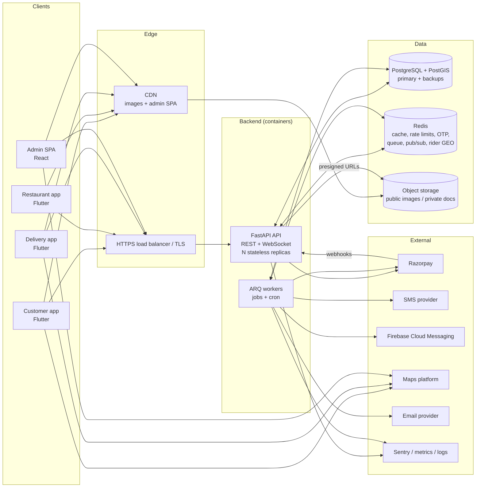
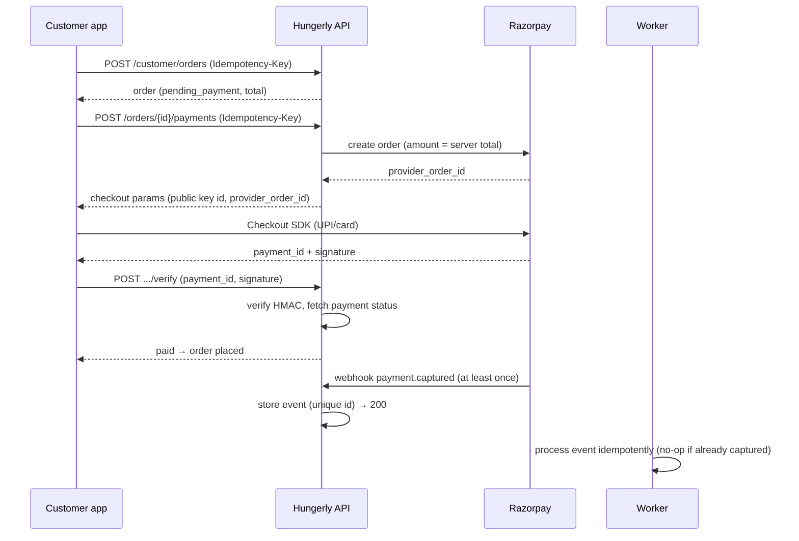

# Hungerly — Architecture Blueprint

> **Status:** Draft v0.1 for review (Phase 0 — Architecture). **Owner:** Hungerly core team. **Last updated:** 2026-09-29.
>
> This document is the architectural source of truth. Detailed companions:
> [DATABASE_SCHEMA.md](DATABASE_SCHEMA.md) · [API_BLUEPRINT.md](API_BLUEPRINT.md) · [FRONTEND_BLUEPRINT.md](FRONTEND_BLUEPRINT.md) · [DEVELOPMENT_ROADMAP.md](DEVELOPMENT_ROADMAP.md) · [SECURITY.md](SECURITY.md) · [decisions/](decisions/)
>
> Changes are made by pull request. Significant decisions get an ADR in `docs/decisions/`.

## Contents

1. [Project overview](#1-project-overview) · 2. [Product vision](#2-product-vision) · 3. [Core objectives](#3-core-objectives) · 4. [User types](#4-user-types) · 5. [Customer workflow](#5-customer-workflow) · 6. [Restaurant workflow](#6-restaurant-workflow) · 7. [Delivery partner workflow](#7-delivery-partner-workflow) · 8. [Admin workflow](#8-admin-workflow) · 9. [Complete feature list](#9-complete-feature-list) · 10. [MVP scope](#10-mvp-scope) · 11. [Post-MVP scope](#11-post-mvp-scope) · 12. [Functional requirements](#12-functional-requirements) · 13. [Non-functional requirements](#13-non-functional-requirements) · 14. [System architecture](#14-system-architecture) · 15. [Application architecture](#15-application-architecture) · 16. [Backend architecture](#16-backend-architecture) · 17. [Frontend architecture](#17-frontend-architecture) · 18. [Database architecture](#18-database-architecture) · 19. [Authentication architecture](#19-authentication-architecture) · 20. [Authorization / RBAC](#20-authorization--rbac) · 21. [API architecture](#21-api-architecture) · 22. [Payment architecture](#22-payment-architecture) · 23. [Notification architecture](#23-notification-architecture) · 24. [Maps / location architecture](#24-maps--location-architecture) · 25. [Order lifecycle](#25-order-lifecycle) · 26. [Restaurant lifecycle](#26-restaurant-lifecycle) · 27. [Delivery lifecycle](#27-delivery-lifecycle) · 28. [Customer lifecycle](#28-customer-lifecycle) · 29. [Admin capabilities](#29-admin-capabilities) · 30. [Database entities](#30-database-entities) · 31. [Entity relationships](#31-entity-relationships) · 32. [Important database fields](#32-important-database-fields) · 33. [API endpoint categories](#33-api-endpoint-categories) · 34. [Frontend applications](#34-frontend-applications) · 35. [Shared packages](#35-shared-packages) · 36. [Monorepo architecture](#36-monorepo-architecture) · 37. [Recommended folder structure](#37-recommended-folder-structure) · 38. [State management strategy](#38-state-management-strategy) · 39. [Error handling](#39-error-handling) · 40. [Logging](#40-logging) · 41. [Monitoring](#41-monitoring) · 42. [Security architecture](#42-security-architecture) · 43. [Rate limiting](#43-rate-limiting) · 44. [Data validation](#44-data-validation) · 45. [File / image storage](#45-file--image-storage) · 46. [Search architecture](#46-search-architecture) · 47. [Caching strategy](#47-caching-strategy) · 48. [Scalability strategy](#48-scalability-strategy) · 49. [Deployment architecture](#49-deployment-architecture) · 50. [Development environment](#50-development-environment) · 51. [Testing strategy](#51-testing-strategy) · 52. [CI/CD strategy](#52-cicd-strategy) · 53. [Environment variables](#53-environment-variables) · 54. [Third-party services](#54-third-party-services) · 55. [Cost-conscious infrastructure strategy](#55-cost-conscious-infrastructure-strategy) · 56. [Future AI/ML integration points](#56-future-aiml-integration-points) · 57. [Observability](#57-observability) · 58. [Backup and disaster recovery](#58-backup-and-disaster-recovery) · 59. [Development phases](#59-development-phases) · 60. [Milestones](#60-milestones) · 61. [Definition of Done](#61-definition-of-done) · 62. [Technical risks](#62-technical-risks) · 63. [Open architectural decisions](#63-open-architectural-decisions) · [Appendix A — Technology decision matrix](#appendix-a--technology-decision-matrix) · [Appendix B — Assumptions](#appendix-b--assumptions)

---

## 1. Project overview

Hungerly is a three-sided food-delivery marketplace connecting **customers** who order food, **restaurants** that prepare it, and **delivery partners** who carry it, operated by the **Hungerly team** through an admin dashboard.

The system consists of:

| Component | Technology (recommended) | Purpose |
|---|---|---|
| Customer app | Flutter (Android, iOS) | Discover restaurants, order, pay, track |
| Restaurant partner app | Flutter (Android/iOS phones and tablets) | Receive and manage orders, manage menu and hours |
| Delivery partner app | Flutter (Android first, iOS) | Accept and complete deliveries, share live location |
| Admin dashboard | React + TypeScript (Vite SPA) | Operations, onboarding, support, finance, analytics |
| Backend API + workers | Python 3.13, FastAPI, SQLAlchemy 2, ARQ | Business logic, APIs, realtime, background jobs |
| Database | PostgreSQL 16+ with PostGIS | System of record |
| Cache / queue / realtime bus | Redis (or Valkey) | Rate limits, OTPs, caching, job queue, pub/sub, rider geo index |
| Object storage | S3-compatible storage + CDN | Images and private KYC documents |

Development is done by a **small team (two developers initially)**, so the architecture favours a **modular monolith**, managed services, and few moving parts.

## 2. Product vision

*"Good food from local restaurants, delivered reliably, with fair terms for restaurants and delivery partners."*

- **Customers**: fast discovery, transparent pricing (no surprise fees at checkout), accurate ETAs, reliable live tracking.
- **Restaurants**: a simple tablet app that never misses an order, clear payouts, a fair commission.
- **Delivery partners**: transparent per-delivery earnings, sensible offers (not far-away pickups), safety.
- **Hungerly**: launch in one city, prove unit economics, expand zone by zone without re-architecture.

## 3. Core objectives

1. Launch an MVP in **one pilot city** that supports the complete loop: discover → order → pay → prepare → dispatch → deliver → rate.
2. **Correctness of money and order state** above all else: no double charges, no lost orders, full audit trail.
3. **Low operating cost** at pilot scale (target: under ~USD 150/month infrastructure for production at pilot volume, excluding SMS/maps/payment fees).
4. **Scale path** to multiple cities and ~10× pilot volume without rewriting core components.
5. **Security and privacy by default**: least-privilege access, protected PII, compliance-ready payments (no card data touches Hungerly systems).
6. **Maintainability** by a small team: one backend language, one mobile framework, generated API clients, strong typing, automated tests and CI.

## 4. User types

| User type | Description | App | Role(s) |
|---|---|---|---|
| Guest | Browses restaurants without signing in | Customer | — |
| Customer | Registered user who orders food | Customer | `customer` |
| Restaurant owner | Legal owner/operator of a restaurant; full control of that restaurant | Restaurant | `restaurant_staff` + `staff_role=owner` |
| Restaurant manager | Manages menu, hours and orders; cannot manage owners or payouts | Restaurant | `restaurant_staff` + `manager` |
| Restaurant staff | Handles orders and availability during service only | Restaurant | `restaurant_staff` + `staff` |
| Delivery partner | Independent rider who delivers orders | Delivery | `delivery_partner` |
| Operations admin | Onboards restaurants/partners, manages live operations, coupons | Admin | `admin` + `operations` |
| Support admin | Looks up users/orders, moderates reviews | Admin | `admin` + `support` |
| Finance admin | Refunds, financial reports | Admin | `admin` + `finance` |
| Super admin | Everything, including admin users, zones, audit logs | Admin | `admin` + `super_admin` |
| System | Scheduled jobs, webhooks, dispatch engine | — | internal actor |

One person may hold several roles (e.g. a restaurant owner who also orders as a customer) with one identity.

## 5. Customer workflow

```
Install → Browse as guest (optional) → Phone OTP login → Name → Set location/address
→ Discover (home, filters, search) → Restaurant menu → Customise items → Cart (one restaurant)
→ Apply coupon / tip / instructions → Place order (server re-prices)
→ Pay online (UPI/card/netbanking via provider) or COD (if enabled)
→ Track: placed → preparing → ready → picked up (live map) → delivered
→ Rate restaurant and delivery → Reorder later
```

Exception paths: payment failure (retry or auto-cancel after 15 min), restaurant rejects (automatic refund), no rider found (ops escalation, then cancel + refund), customer cancels before acceptance (refund), item unavailable at cart time (blocked checkout with explanation).

## 6. Restaurant workflow

```
Owner signs up (phone OTP) → Onboarding wizard (details, location, cuisines, hours, documents)
→ Submit → Admin review (documents, commission, zone) → Approved → Build menu
→ Go online during hours → New order alert (sound) → Accept with prep time / Reject with reason
→ Prepare → Mark ready → Rider picks up → Order complete
→ Toggle item availability during service → View insights, reviews → Manage staff
```

Exception paths: order not acknowledged within timeout → auto-cancel + refund + restaurant set offline after repeated misses; document expiry → reminder then suspension; suspension by admin.

## 7. Delivery partner workflow

```
Sign up (phone OTP) → Onboarding (personal, zone, vehicle, documents) → Admin verification
→ Grant permissions (location incl. background, notifications) → Go online
→ Receive offer (pickup distance, drop distance, payout, countdown) → Accept / reject
→ Navigate to restaurant → Arrived → Pick up → Navigate to customer → Arrived
→ Handoff (delivery OTP if enabled; collect COD if applicable) → Delivered → Next offer
→ View history and earnings → Go offline
```

Exception paths: offer expires → offered to the next partner; customer unreachable → issue report → ops decides (wait/return/cancel); order cancelled mid-way → partner notified, compensation rule (open decision).

## 8. Admin workflow

```
Login (email + password + TOTP) → Live operations dashboard
→ Review pending restaurants and partners (documents) → Approve/reject/suspend
→ Monitor delayed orders → Intervene: reassign rider, cancel order, refund
→ Support: find user/order, resolve complaints, moderate reviews
→ Configure: cities, zones & pricing, cuisines, coupons, admin users
→ Analyse: orders, GMV, cancellations, delivery performance, finance reports, exports
```

## 9. Complete feature list

Legend: **M** = MVP, **P** = post-MVP, **F** = future/AI.

| Area | Feature | Scope |
|---|---|---|
| Auth | Phone OTP login (customer, restaurant, delivery) | M |
| Auth | Email + password + TOTP for admins | M |
| Auth | Session management (list/revoke devices) | M |
| Auth | Email/password login for restaurant staff | P |
| Auth | Social login (Google/Apple) | P |
| Customer | Profile, addresses with map pin, favourites | M |
| Customer | Serviceability check by location | M |
| Discovery | Nearby restaurants list with filters (cuisine, veg, rating, ETA) and sort | M |
| Discovery | Search restaurants and dishes (text) | M |
| Discovery | Personalised recommendations, "because you ordered" | F |
| Discovery | Collections/curated lists, banners | P |
| Menu | Categories, items, veg/non-veg/egg, images, variants and add-ons | M |
| Menu | Item and option availability toggles | M |
| Menu | Scheduled availability (breakfast menu), combos | P |
| Cart | Single-restaurant cart, server-side pricing, coupons, tip, instructions | M |
| Ordering | Place order, idempotent; order tracking timeline; history; reorder | M |
| Ordering | Customer cancellation before acceptance | M |
| Ordering | Scheduled orders, group orders | P |
| Payments | Online payments via Razorpay (UPI, cards, netbanking, wallets) | M |
| Payments | Cash on delivery (feature-flagged per zone) | M (flagged) |
| Payments | Automatic refunds on cancellation/rejection; admin partial refunds | M |
| Payments | Automated restaurant settlements and partner payouts | P |
| Payments | Saved payment methods (via provider tokenisation) | P |
| Restaurant | Onboarding with documents; admin approval | M |
| Restaurant | Order board with alerts, accept/reject/ready/delay | M |
| Restaurant | Hours, holiday exceptions, online/offline toggle | M |
| Restaurant | Staff management with roles | M |
| Restaurant | Insights (sales, orders, rating, prep time) | M (basic) |
| Restaurant | Reply to reviews, promotions, invoices/settlement statements | P |
| Restaurant | Printer (KOT) integration, POS integration | P |
| Delivery | Onboarding with documents; admin approval | M |
| Delivery | Online/offline, background location, offers with countdown | M |
| Delivery | Pickup/drop flow, delivery OTP, COD collection | M |
| Delivery | History and earnings summary | M |
| Delivery | Batched (multi-order) deliveries, shift booking, incentives | P |
| Delivery | Masked calling between rider and customer | P (open decision for MVP) |
| Dispatch | Nearest-available-partner sequential offers | M |
| Dispatch | Optimised dispatch (batching, predicted ready time) | F |
| Notifications | Push (FCM) + in-app inbox for order/delivery/account events | M |
| Notifications | SMS for OTP; SMS fallback for critical order events | M (OTP) / P (fallback) |
| Notifications | Email for admin and restaurant onboarding | M (minimal) |
| Notifications | Marketing campaigns with segmentation | P |
| Reviews | Order ratings (restaurant + delivery), public restaurant reviews | M |
| Reviews | Moderation (flag/hide) | M |
| Admin | Live ops dashboard, restaurant/partner management, orders, users, coupons, zones, cuisines, admins, audit log | M |
| Admin | Analytics overview, finance report, CSV export | M (basic) |
| Admin | Support ticketing, CRM, fraud tooling | P |
| Platform | Multi-city, zone-based pricing, feature flags, minimum app version | M |
| Platform | Multi-language UI | P |
| Platform | Customer web ordering (SEO pages) | P |
| AI | ETA prediction, recommendations, search ranking, fraud detection, review summarisation, menu digitisation | F |

## 10. MVP scope

**Goal:** a complete, reliable order loop in one city with a limited number of onboarded restaurants and partners.

In MVP:
- Customer app (Android + iOS): OTP login, location & addresses, discovery, search, menu with options, cart, coupons (platform), tip, online payment, COD (flag), tracking with live rider location after pickup, order history, reorder, ratings, favourites, inbox, account deletion.
- Restaurant app: OTP login, onboarding + documents, order board with loud alerts, accept/reject/ready/delay, menu management with options and availability, hours and exceptions, online/offline, staff roles, basic insights, reviews.
- Delivery app: OTP login, onboarding + documents, permissions flow, online/offline, background location, offers, pickup/drop flow, delivery OTP, COD recording, history, earnings summary.
- Admin: MFA login, live ops, restaurant & partner verification, order management with cancel/reassign/refund, user lookup/suspend, coupons, cities/zones/pricing, cuisines, review moderation, basic analytics & finance exports, admin users, audit log.
- Backend: all APIs above, dispatch v1, payment integration with webhooks and reconciliation job, notifications (push, inbox, SMS OTP), scheduled jobs (timeouts, purges, rating aggregation), observability, backups.

Explicitly **not** in MVP: automated payouts/settlements (done manually from finance exports), batching, scheduled/group orders, customer web ordering, multi-language, loyalty, masked calling (unless decided otherwise), restaurant review replies, printer/POS integration, AI features.

## 11. Post-MVP scope

Ordered by expected value (to be re-prioritised with real data):

1. Automated restaurant settlements and partner payouts (Razorpay Route / RazorpayX).
2. Masked calling and in-app chat between rider, customer and support.
3. Support tickets with in-app help.
4. Dispatch v2: dispatch timed to predicted food-ready time; batching of two orders from the same restaurant.
5. Restaurant promotions, review replies, invoices and GST reports.
6. Multi-language apps (Hindi, Marathi, …).
7. Customer web ordering with SEO (Next.js) if marketing needs it.
8. Scheduled orders; loyalty/membership.
9. Data warehouse for analytics; AI features (§56).
10. Multi-region/multi-city scaling improvements (§48).

## 12. Functional requirements

IDs are referenced by tests and PRs.

**Authentication & accounts**
- FR-AUTH-1: Users sign in with phone number + SMS OTP (6 digits, 5-minute validity, max 5 attempts).
- FR-AUTH-2: Admins sign in with email + password + TOTP; OTP login is not allowed for admins.
- FR-AUTH-3: Sessions are per device; users can list and revoke sessions; logout revokes the session.
- FR-AUTH-4: Suspended users cannot sign in or call APIs; active sessions are revoked on suspension.
- FR-AUTH-5: Customers can request account deletion; PII is erased/anonymised within 30 days except where retention is legally required.

**Discovery & menu**
- FR-DISC-1: Given a location, the system lists active restaurants in the serving zone within the zone's radius, with open/closed status, ETA and fee.
- FR-DISC-2: Users can filter by cuisine, veg-only, rating, delivery time and sort by relevance, rating, delivery time, distance.
- FR-DISC-3: Users can search restaurants and dishes by name with typo tolerance.
- FR-MENU-1: Restaurants manage categories, items (price, food type, image, description) and option groups with min/max selections.
- FR-MENU-2: Staff can mark items/options unavailable instantly; the customer menu reflects this within 60 seconds.

**Cart & ordering**
- FR-CART-1: A cart holds items from one restaurant; adding from another requires confirmation to replace.
- FR-CART-2: Prices, fees, taxes, discounts and totals are computed by the server on every cart read and at order placement.
- FR-ORD-1: Placing an order is idempotent per `Idempotency-Key`.
- FR-ORD-2: If the price changed since the customer last saw it, placement fails with the new bill for confirmation.
- FR-ORD-3: Order status follows the state machine in §25; each transition is recorded with actor and time.
- FR-ORD-4: Restaurants must accept or reject a placed order within a configurable timeout; otherwise it is auto-cancelled and refunded.
- FR-ORD-5: Customers can cancel before the restaurant accepts; cancellation after acceptance requires support.

**Payments**
- FR-PAY-1: Online payments use the payment provider's checkout; Hungerly never handles card data.
- FR-PAY-2: An order is marked paid only after server-side verification (signature + provider status or webhook).
- FR-PAY-3: An order can have at most one captured payment.
- FR-PAY-4: Cancellation of a paid order triggers an automatic full refund; admins (finance) can issue partial refunds up to the captured amount.
- FR-PAY-5: A daily reconciliation job compares provider records with local payments and flags mismatches.

**Delivery**
- FR-DEL-1: After acceptance, the system offers the order to the nearest eligible online partner; offers expire after 30 seconds (configurable) and move to the next partner.
- FR-DEL-2: A partner has at most one active delivery (MVP).
- FR-DEL-3: Partners share location every ~10 s while online and ~5 s during an active delivery; customers see the rider on a map after pickup.
- FR-DEL-4: Pickup and delivery confirmations are geofence-checked (configurable tolerance).
- FR-DEL-5: If no partner accepts within a configurable time, ops is alerted on the live dashboard.

**Restaurants & partners onboarding**
- FR-ONB-1: Restaurants and partners submit profile and documents; admins approve/reject each document and the application.
- FR-ONB-2: Only approved (active) restaurants appear to customers; only active partners can go online.

**Notifications**
- FR-NOT-1: Customers receive push + inbox notifications for key order events (placed, accepted, picked up, delivered, cancelled, refunded).
- FR-NOT-2: Restaurants receive a high-priority, sound-enabled alert for new orders.
- FR-NOT-3: Partners receive high-priority offer notifications.

**Ratings, admin, analytics**
- FR-RAT-1: Customers can rate delivered orders within 7 days; restaurant rating averages update asynchronously.
- FR-ADM-1: All admin mutations are audit-logged with actor, before/after and reason.
- FR-ADM-2: Admin access is limited by sub-role (§20).
- FR-ANL-1: Admins see GMV, orders, AOV, cancellation rate, delivery time metrics for a date range and city, and can export CSV.

## 13. Non-functional requirements

| Category | Requirement (MVP target) |
|---|---|
| Availability | 99.5% monthly for API during operating hours; planned maintenance outside peak meal times |
| Latency | API p95 < 300 ms reads, < 800 ms order placement (excluding provider calls); realtime event delivery p95 < 3 s |
| Throughput | Pilot: ~2,000 orders/day, peak ~5 orders/second placement, ~500 concurrent online riders sending location every 5–10 s (~100 writes/s). Design headroom 10× |
| Durability | Zero loss of committed orders/payments; RPO ≤ 5 minutes, RTO ≤ 4 hours (§58) |
| Consistency | Orders, payments, assignments: strong consistency (single PostgreSQL primary, transactions, constraints). Listings, ratings, analytics: eventual consistency acceptable |
| Security | OWASP ASVS L2 as the target baseline; OWASP API Top 10 addressed; see SECURITY.md |
| Privacy | Data minimisation, masked contact details, retention limits, account deletion; alignment with India's DPDP Act 2023 (legal review pending) |
| Maintainability | Typed code (mypy strict on backend core, Dart analyzer strict, TS strict); ≥ 80% line coverage on backend domain services; generated API clients |
| Portability | Everything runs in containers; no proprietary cloud APIs in core logic (storage and email behind interfaces) |
| Observability | Every request traceable by `request_id` across logs, errors and audit entries |
| Mobile | Cold start < 3 s on mid-range Android; works on Android 8+ and iOS 15+ (to be confirmed with Flutter's minimums); APK size target < 30 MB |
| Accessibility | WCAG 2.1 AA for admin; platform accessibility guidelines for mobile |
| Cost | See §55 |

## 14. System architecture



**Key properties**
- **Modular monolith**: one deployable backend (API + worker entrypoints from one code base), internally split into domain modules with enforced boundaries (§16). Split out services only when a module has a proven, different scaling or ownership need (likely candidates: dispatch/location, notifications).
- **Stateless API replicas**: all state in PostgreSQL/Redis, so the API scales horizontally behind the load balancer. WebSocket fan-out uses Redis pub/sub so any replica can deliver to any connected client.
- **Asynchronous side effects**: notifications, provider calls not needed in the request path, rating aggregation, reconciliation and purges run in workers. State changes and job enqueueing are made reliable with a **transactional outbox** (§16.4).

## 15. Application architecture

| Layer | Responsibility | Where |
|---|---|---|
| Presentation | Screens, navigation, UI state | Flutter apps, admin SPA |
| Client application logic | Session, caching of server state, form validation (UX only) | Riverpod / TanStack Query |
| API contract | OpenAPI spec generated from backend schemas; generated Dart and TS clients | `backend` → `contracts/` → `packages/hungerly_api`, `packages/api-client-ts` |
| API layer | HTTP routing, auth dependencies, request/response schemas, error mapping | `backend/app/modules/*/router.py` |
| Domain services | Business rules, state machines, authorization policies, transactions | `backend/app/modules/*/service.py`, `policies.py` |
| Data access | SQLAlchemy models and repositories | `backend/app/modules/*/models.py`, `repository.py` |
| Integrations | Payment, SMS, push, maps, storage, email adapters behind interfaces | `backend/app/integrations/*` |
| Async processing | Jobs, cron, outbox relay, dispatch loop | `backend/app/workers/*` |

Rule: **business rules live only in backend domain services.** Clients may duplicate validation for UX, but never logic that affects money, state or access.

## 16. Backend architecture

### 16.1 Stack

| Concern | Choice |
|---|---|
| Language/runtime | Python 3.13 |
| Web framework | FastAPI (ASGI) on Uvicorn workers |
| Validation/schemas | Pydantic v2 |
| ORM / SQL | SQLAlchemy 2.x (async, typed `Mapped[]` models) with asyncpg |
| Migrations | Alembic (reviewed, never auto-applied blindly; expand/contract pattern) |
| Background jobs | ARQ (asyncio Redis queue) including cron jobs |
| Geospatial | PostGIS + GeoAlchemy2 |
| Settings | pydantic-settings (env vars, validated at startup) |
| Logging | structlog (JSON) |
| Package/env manager | uv |
| Lint/format/types | Ruff (lint + format), mypy |
| Tests | pytest, pytest-asyncio, httpx AsyncClient, Testcontainers/CI service containers for PostgreSQL + Redis, factory helpers |

See [ADR-002](decisions/ADR-002-backend.md) for why FastAPI/Python over Node.js (NestJS), Go and Django.

### 16.2 Module layout

```
backend/app/
  main.py                    # app factory: routers, middleware, exception handlers
  core/                      # config, db session, security (JWT, hashing), errors, logging, pagination, idempotency, rate limit
  integrations/              # payments/, sms/, push/, maps/, storage/, email/ — each: interface + provider adapter + fake for tests
  modules/
    auth/  users/  customers/  geo/  restaurants/  menu/  cart/  orders/
    payments/  delivery/  dispatch/  notifications/  reviews/  promotions/
    uploads/  admin/  analytics/  audit/
      router.py  schemas.py  service.py  repository.py  models.py  policies.py  events.py
  realtime/                  # WebSocket endpoint, connection registry, Redis pub/sub bridge
  workers/                   # ARQ settings, job functions, cron schedule, outbox relay
backend/migrations/          # Alembic
backend/tests/               # unit/, integration/, api/, contract/
```

### 16.3 Module boundary rules
1. A module may import another module **only through its `service.py` public functions** or domain events — never its models/repositories.
2. Cross-module writes in one transaction go through the owning module's service (e.g. `orders.service` calls `promotions.service.reserve_coupon(...)` within the same unit of work).
3. Routers contain no business logic; they call services and map results to schemas.
4. Provider SDKs are used only inside `integrations/`.
5. Boundaries are checked in CI with `import-linter` contracts.

### 16.4 Reliability patterns
- **Unit of work:** one DB transaction per command; state change + `order_status_events` + outbox row committed together.
- **Transactional outbox:** events (`order.placed`, `order.accepted`, …) are written to an `outbox_events` table in the same transaction and relayed to Redis (queue/pub-sub) by a worker. Guarantees no "order saved but restaurant never notified" gap. (See `outbox_events` in DATABASE_SCHEMA.md §4.11.)
- **Idempotency:** idempotency keys for client commands; unique constraints for webhooks and payments.
- **Optimistic locking:** `version` columns + `If-Match` on order/assignment transitions; `SELECT … FOR UPDATE` for coupon limits and refunds.
- **Timeouts & retries:** all outbound HTTP calls have timeouts; retries with exponential backoff and jitter only for idempotent operations; a circuit breaker around providers.
- **Scheduled safety nets:** payment timeout cancellation, restaurant acceptance timeout, dispatch escalation, daily payment reconciliation.

## 17. Frontend architecture

Summary (details in [FRONTEND_BLUEPRINT.md](FRONTEND_BLUEPRINT.md)):
- **Three Flutter apps** sharing three Dart packages: `hungerly_api` (generated client), `hungerly_core` (networking, auth, config, errors, realtime, push), `hungerly_ui` (design system).
- Feature-first folder structure; Riverpod for state/DI; go_router for navigation and deep links; Dio for HTTP.
- **Admin**: React + TypeScript SPA built with Vite, TanStack Query/Table, React Router, React Hook Form + Zod, Tailwind + shadcn/ui, generated TS client.
- Build flavours `dev` / `staging` / `prod`; configuration via build-time defines; **no secrets in any client**.

## 18. Database architecture

- **PostgreSQL 16+** as the single system of record, with **PostGIS** (geo), **citext** (case-insensitive email/codes) and **pg_trgm** (fuzzy search) extensions. See [ADR-003](decisions/ADR-003-database.md).
- One logical database, **one schema per environment**; tables are owned by backend modules (naming prefix not required, ownership documented in DATABASE_SCHEMA.md).
- UUIDv7 primary keys, money as integer minor units, `timestamptz`, CHECK/UNIQUE/FK constraints enforced in the database.
- Connection pooling: SQLAlchemy pool per process; add PgBouncer (transaction mode) when replica count × pool size approaches the DB connection limit.
- Read scaling: add a read replica for analytics/admin reports when needed; OLTP stays on the primary.
- Migrations: Alembic, forward-only in production, **expand → migrate → contract** for zero-downtime changes; every migration reviewed in PR.
- Full schema: [DATABASE_SCHEMA.md](DATABASE_SCHEMA.md).

## 19. Authentication architecture

| Actor | Method | Token delivery |
|---|---|---|
| Customer, delivery partner, restaurant staff | Phone + SMS OTP | Mobile: access token in memory, refresh token in platform secure storage (Keychain / Android Keystore via `flutter_secure_storage`) |
| Admin | Email + password (Argon2id) + TOTP (mandatory) | Access token in memory; refresh token in `HttpOnly; Secure; SameSite=Strict` cookie + CSRF header |

- **Access token:** JWT signed with **EdDSA (Ed25519)** or ES256 (asymmetric, so verification keys can be shared without signing ability), 15-minute lifetime, claims: `sub` (user id), `sid` (session id), `roles`, `app` (client app), `iat`, `exp`, `jti`, `kid`. No PII in tokens.
- **Refresh token:** opaque random 256-bit value, stored **hashed** in `auth_sessions`; rotated on every use; reuse of an old token revokes the session (theft detection). Sliding 30-day expiry, 90-day absolute (admin: 12-hour sliding, 7-day absolute).
- **Revocation:** access tokens are short-lived; for immediate revocation (suspension, session revoke) the API checks a Redis deny-list of revoked `sid`s (cheap lookup) on each request.
- **OTP:** generated with a CSPRNG, stored hashed with TTL in Redis, bound to phone + `otp_request_id`, max attempts, resend cooldown, per-phone/IP/device rate limits; SMS templates DLT-registered (India).
- **Why in-house and not a hosted identity provider:** see [ADR-004](decisions/ADR-004-authentication.md) — phone-OTP-centric, multi-app, role-scoped sessions are straightforward to own, avoid per-MAU pricing, and keep one source of truth for roles; the implementation uses well-reviewed libraries (no custom crypto).

## 20. Authorization / RBAC

Three layers, all enforced in the backend:

1. **Coarse role (from `user_roles`)** — which API surface a caller may use: `customer` → `/customer/*`; `restaurant_staff` → `/partner/*`; `delivery_partner` → `/delivery/*`; `admin` → `/admin/*`.
2. **Scoped role** — permission within a scope:
   - Restaurant scope (`restaurant_staff.staff_role`): owner ⊃ manager ⊃ staff.
   - Admin scope (`admin_profiles.admin_role`): super_admin ⊃ {operations, support, finance}.
3. **Ownership/resource policies** — e.g. a customer can only see their own orders; a rider can act only on their own assignment; staff can only access restaurants they belong to.

**Permission matrix (MVP, abbreviated)**

| Permission | Customer | Staff | Manager | Owner | Rider | Support | Ops | Finance | Super |
|---|---|---|---|---|---|---|---|---|---|
| Place/cancel own order | ✓ | | | | | | | | |
| View restaurant orders | | ✓ | ✓ | ✓ | | | | | |
| Accept/reject/ready orders | | ✓ | ✓ | ✓ | | | | | |
| Toggle availability / online | | ✓ | ✓ | ✓ | | | | | |
| Edit menu, hours | | | ✓ | ✓ | | | | | |
| Manage staff | | | staff only | ✓ | | | | | |
| Restaurant documents, payout info | | | | ✓ | | | | | |
| Accept offers, update delivery | | | | | ✓ (own) | | | | |
| View any order / user | | | | | | ✓ | ✓ | ✓ | ✓ |
| Cancel order, reassign rider | | | | | | | ✓ | | ✓ |
| Refund | | | | | | | | ✓ | ✓ |
| Approve restaurants / partners, coupons | | | | | | | ✓ | | ✓ |
| Moderate reviews | | | | | | ✓ | ✓ | | ✓ |
| Zones & pricing, admin users, audit log | | | | | | | | | ✓ |

Implementation: permissions are declared as named policies (e.g. `can_refund(actor, payment)`) in each module's `policies.py`, used as FastAPI dependencies and inside services. Unauthorized resource access returns `404` where revealing existence would leak information. Policy tests are mandatory for every endpoint.

## 21. API architecture

- **REST + JSON over HTTPS**, versioned (`/api/v1`), separated by actor surface (`/customer`, `/catalog`, `/partner`, `/delivery`, `/admin`, `/webhooks`). See [API_BLUEPRINT.md](API_BLUEPRINT.md) and [ADR-007](decisions/ADR-007-api-contract.md).
- **Contract:** OpenAPI generated from Pydantic schemas, committed to `contracts/openapi.json`; CI checks drift; Dart and TypeScript clients generated from it.
- **Errors:** RFC 9457 Problem Details with stable `code`s.
- **Pagination:** cursor-based.
- **Concurrency:** `Idempotency-Key` for money/order commands; `If-Match` versions for state transitions.
- **Realtime:** WebSocket (`/ws/v1`) for server→client events with Redis pub/sub fan-out; push notifications for background delivery; REST polling fallback.
- **Webhooks:** raw-body signature verification, durable storage, async idempotent processing.

## 22. Payment architecture

**Provider: Razorpay** (recommended for India: UPI, cards, netbanking, wallets; well-supported Flutter SDK; Route for marketplace splits later). See [ADR-009](decisions/ADR-009-payments.md). Integration is behind a `PaymentGateway` interface so a second provider (e.g. Cashfree, PayU) can be added.



Rules:
- The **amount is always computed by the server**; the client never sends the amount to charge.
- Order becomes `placed` only after verified capture (client-verify path or webhook path — whichever first; both idempotent).
- **Auto-capture** enabled (captured on authorisation) to keep the MVP simple; refunds handle cancellations.
- **Refunds** via provider API from workers; status tracked in `refunds`; failures alert finance.
- **Reconciliation:** daily job pulls provider settlements/payments for the previous day and compares with `payments`/`refunds`; mismatches are flagged for finance.
- **COD:** feature-flagged per zone; COD amount recorded on delivery; partner cash reconciliation process is an open decision (§63).
- **Marketplace money flow (MVP):** all money collected into Hungerly's account; restaurant payouts calculated from finance exports and paid manually/weekly. **Post-MVP:** Razorpay Route to split at source and automate settlements. Legal/tax treatment (e.g. GST on platform-supplied restaurant services, TCS) requires expert review (§63).
- PCI DSS scope is minimised to SAQ-A-equivalent: no card data is collected, transmitted or stored by Hungerly.

## 23. Notification architecture

```
Domain event (outbox) → notifications worker → template + user preferences + app routing
   ├── in-app inbox (notifications table) → WebSocket `notification.created`
   ├── push (FCM → Android / APNs via FCM → iOS)
   ├── SMS (OTP only in MVP; critical fallback post-MVP)
   └── email (admin/onboarding)
```

- **Channels:** FCM for push (free, one integration for Android + iOS); SMS provider for OTP (DLT-registered templates); transactional email provider for admin/onboarding.
- **Priorities:** restaurant new-order and rider offer notifications use high-priority data messages and dedicated Android notification channels with sound; customer order updates normal priority.
- **Templates** live in code (versioned, reviewed), keyed by event type and app; localisable later.
- **Preferences:** transactional notifications cannot be disabled; promotional ones are opt-in.
- **Reliability:** invalid tokens are removed on FCM errors; retries with backoff; each notification delivery attempt logged (metrics: sent, failed, latency).

## 24. Maps / location architecture

| Need | MVP approach | Later |
|---|---|---|
| Address entry | Place autocomplete + map pin in customer app | Address validation, saved-pin quality scoring |
| Geocoding | Client-side Places/Geocoding; server stores only coordinates + text; results not re-geocoded on server | Server-side geocode cache |
| Serviceability | PostGIS `ST_Covers(zone.boundary, point)` | — |
| Restaurants near me | PostGIS `ST_DWithin` on GiST-indexed `restaurants.location` | Precomputed per-zone lists in cache |
| Distance & ETA | Haversine distance × road factor (e.g. 1.3) ÷ zone average speed + prep time | Routing API (Distance Matrix) for dispatch; ML ETA (§56) |
| Rider live position | Rider app → `POST /delivery/location` → Redis GEO set per zone (TTL) + pub/sub to tracking customer; breadcrumbs to `delivery_location_pings` during active assignment | Dedicated location service if write volume demands |
| Dispatch candidate search | Redis `GEOSEARCH` within radius of restaurant, filtered by online + idle | Scoring (acceptance rate, direction, batching) |
| Navigation | Deep link to Google Maps/other navigation apps from the rider app | In-app turn-by-turn not planned |
| Maps rendering | Google Maps SDK (mobile + admin) | — |

**Provider:** Google Maps Platform recommended for MVP (best address/POI coverage in India), with strict API key restrictions (app signature / HTTP referrer), quotas and budget alerts. **Cost control:** use session tokens for autocomplete, avoid server-side Distance Matrix in MVP, cache geocodes. Ola Maps / Mapbox are cost alternatives recorded in §63.

## 25. Order lifecycle

```mermaid
stateDiagram-v2
    [*] --> pending_payment: place order (online)
    [*] --> placed: place order (COD)
    pending_payment --> placed: payment captured
    pending_payment --> cancelled: payment timeout (15 min) / customer cancels
    placed --> preparing: restaurant accepts (prep time)
    placed --> cancelled: restaurant rejects / acceptance timeout / customer cancels / admin
    preparing --> ready_for_pickup: restaurant marks ready
    preparing --> picked_up: rider picks up (ready not marked; flagged)
    preparing --> cancelled: admin (e.g. no rider) → refund
    ready_for_pickup --> picked_up: rider confirms pickup
    ready_for_pickup --> cancelled: admin → refund
    picked_up --> delivered: rider confirms delivery
    picked_up --> cancelled: admin (delivery failed) → refund policy
    delivered --> [*]
    cancelled --> [*]
```



- Dispatch starts when the order enters `preparing` (v1). Dispatch v2 will delay offers to match predicted ready time.
- `payment_status` evolves independently (`pending → paid → refund_pending → refunded`), so refunds never alter the fulfilment history.
- All transitions are validated by one state-machine function in `orders.service`; invalid transitions return `409 order.invalid_transition`.

## 26. Restaurant lifecycle

```
draft → pending_review → active ⇄ suspended
                      ↘ rejected → (edit) → pending_review
active → closed (permanent, by owner request or admin)
```
- `draft`: owner filling onboarding data; not visible.
- `pending_review`: submitted; editing locked except document replacement requested by admin.
- `active`: visible when `is_accepting_orders` and within hours.
- `suspended`: hidden; reasons include expired FSSAI licence, quality, fraud, repeated missed orders. Reinstatement by ops.
- Operational sub-state (daily): offline / online / busy (post-MVP "busy mode" increases prep times).

## 27. Delivery lifecycle

Partner lifecycle: `onboarding → pending_review → active ⇄ suspended`, `rejected`, `offboarded`.

Assignment lifecycle (per order):
```
offered → accepted → arrived_at_restaurant → picked_up → arrived_at_customer → delivered
offered → rejected | expired            (next candidate is offered)
accepted/… → cancelled (order cancelled) | failed (issue resolved as failed delivery)
```
Dispatch v1 algorithm:
1. On `order.accepted`, find online, idle, active partners in the zone within R km of the restaurant (Redis GEOSEARCH), ordered by distance, excluding those who rejected this order.
2. Offer to the best candidate (sequential, 30 s expiry). On reject/expiry, next candidate; expand radius after K attempts.
3. After T minutes without acceptance, flag the order on the live ops dashboard; ops can assign manually.
4. Acceptance is atomic (row lock + partial unique index) so two partners can never hold the same order.

## 28. Customer lifecycle

```
guest → registered (OTP) → first order → repeat customer
        ↘ inactive (no order in 60 days; re-engagement post-MVP)
any → suspended (fraud/abuse, by admin) → reinstated
any → deletion requested → PII erased (≤ 30 days) → deleted
```
Customer-level signals tracked for later: order count, cancellation rate, COD refusal count (for COD eligibility), lifetime value.

## 29. Admin capabilities

- **Operations:** live dashboard; delayed-order alerts; manual rider assignment/reassignment; cancel orders; restaurant/partner onboarding and document verification; suspend/reinstate; coupons; cuisines.
- **Support:** find users/orders by phone/order number; view full order timeline, payments, assignments; moderate reviews; revoke user sessions.
- **Finance:** refunds (partial/full); finance reports and CSV exports (collections, refunds, commission, payables); reconciliation mismatch review.
- **Super admin:** cities, zones, pricing; admin users and sub-roles; audit log; platform settings (feature flags such as COD per zone, minimum app versions, timeouts).
- Every mutation: reason required for destructive actions, audit-logged, permission-checked.

## 30. Database entities

Full definitions in [DATABASE_SCHEMA.md](DATABASE_SCHEMA.md). MVP entities by domain:

- **Identity & access:** `users`, `user_roles`, `auth_sessions`, `device_tokens`, `customer_profiles`, `admin_profiles`
- **Geography:** `cities`, `service_zones`, `addresses`
- **Restaurants:** `restaurants`, `restaurant_staff`, `restaurant_hours`, `restaurant_hour_exceptions`, `restaurant_documents`, `cuisines`, `restaurant_cuisines`
- **Menu:** `menu_categories`, `menu_items`, `menu_option_groups`, `menu_options`
- **Cart:** `carts`, `cart_items`, `cart_item_options`
- **Orders:** `orders`, `order_items`, `order_item_options`, `order_status_events`
- **Payments:** `payments`, `payment_webhook_events`, `refunds`, `payout_accounts`
- **Delivery:** `delivery_partners`, `delivery_partner_documents`, `delivery_assignments`, `delivery_location_pings`
- **Promotions:** `coupons`, `coupon_redemptions`
- **Engagement:** `order_ratings`, `favorites`, `notifications`
- **Platform:** `audit_logs`, `outbox_events` (technical), `platform_settings` (feature flags/config, technical)

## 31. Entity relationships

- `users` 1—N `user_roles`; 1—1 optional `customer_profiles`, `admin_profiles`, `delivery_partners`.
- `users` N—M `restaurants` via `restaurant_staff` (with per-restaurant role).
- `cities` 1—N `service_zones` 1—N `restaurants`, `delivery_partners`.
- `restaurants` 1—N `menu_categories` 1—N `menu_items` 1—N `menu_option_groups` 1—N `menu_options`.
- `users` 1—1 `carts` 1—N `cart_items` N—M `menu_options`.
- `orders` N—1 `users` (customer), N—1 `restaurants`; 1—N `order_items` 1—N `order_item_options`; 1—N `order_status_events`.
- `orders` 1—N `payments` (≤ 1 captured) 1—N `refunds`.
- `orders` 1—N `delivery_assignments` (≤ 1 active) N—1 `delivery_partners`.
- `orders` 1—0..1 `coupon_redemptions`, 1—0..1 `order_ratings`.
- ER diagram: [DATABASE_SCHEMA.md §3](DATABASE_SCHEMA.md#3-entityrelationship-diagram-mvp-core).

## 32. Important database fields

| Field | Why it matters |
|---|---|
| `orders.status`, `orders.payment_status`, `orders.version` | State machine and concurrency control |
| `orders.*_minor`, `orders.total_minor` + CHECK | Money correctness enforced by the DB |
| `orders.idempotency_key` (UQ per customer) | No duplicate orders on retries |
| `orders.delivery_address` (jsonb snapshot), `order_items.name/unit_price_minor` | Historical accuracy |
| `payments.provider_order_id`/`provider_payment_id` (UQ), partial UQ captured-per-order | No double charge; reconciliation |
| `payment_webhook_events.provider_event_id` (UQ) | Exactly-once webhook processing |
| `delivery_assignments.status` + partial UQs | One rider per order; one order per rider |
| `restaurants.status`, `is_accepting_orders`, `location` | Visibility and geo search |
| `service_zones.boundary` | Serviceability and pricing |
| `auth_sessions.refresh_token_hash`, `previous_token_hash`, `revoked_at` | Secure sessions and theft detection |
| `audit_logs.*` | Accountability |

## 33. API endpoint categories

Authentication · Customer (profile, addresses, favourites) · Catalog (restaurants, search, menu) · Partner (restaurant profile, hours, menu management, orders, staff, reports) · Cart · Orders · Payments · Delivery (onboarding, availability, location, offers, assignments, earnings) · Notifications · Reviews · Uploads · Admin · Analytics · Webhooks · Realtime (WebSocket) · Health. Full catalogue: [API_BLUEPRINT.md §3](API_BLUEPRINT.md#3-endpoint-catalogue).

## 34. Frontend applications

| App | Tech | Primary device | Key constraints |
|---|---|---|---|
| Customer | Flutter | Android + iOS phones | Performance on low/mid-range Android, payments SDK, maps, deep links |
| Restaurant | Flutter | Android tablet at counter; owner's phone | Never miss an order: loud alerts, keep-awake option, reconnect logic |
| Delivery | Flutter | Android phones | Background location with foreground service, battery, outdoor readability, poor connectivity |
| Admin | React + Vite SPA | Desktop browser | Dense tables, maps (zones), role-based screens, strong security (MFA, CSP) |

Screens: [FRONTEND_BLUEPRINT.md](FRONTEND_BLUEPRINT.md).

## 35. Shared packages

| Package | Language | Consumers | Contents |
|---|---|---|---|
| `packages/hungerly_api` | Dart (generated) | 3 Flutter apps | API client + models from `contracts/openapi.json` |
| `packages/hungerly_core` | Dart | 3 Flutter apps | HTTP/auth/session, config, errors, realtime, push, logging, formatting |
| `packages/hungerly_ui` | Dart | 3 Flutter apps | Design tokens, theme, shared widgets, status vocabulary |
| `packages/api-client-ts` | TypeScript (generated) | Admin | Types + fetch client from the same OpenAPI |
| `contracts/` | JSON/YAML | all | `openapi.json` (generated, committed), shared event schemas (WebSocket/push payloads) |
| Config | per toolchain | — | `analysis_options.yaml` (Dart), `tsconfig.base.json`, ESLint config, Ruff/mypy in `backend/pyproject.toml` |

**Why not a single cross-language "shared/types" package:** the Dart and TypeScript clients cannot share source; the **OpenAPI contract is the shared types layer**, and generated code prevents drift. A generic `utilities` package is intentionally not created up front — shared code is extracted into `hungerly_core` only when used by at least two apps (avoid speculative abstractions).

## 36. Monorepo architecture

One Git repository containing all apps, the backend, shared packages, contracts, infrastructure and docs. See [ADR-001](decisions/ADR-001-monorepo.md).

**Tooling (polyglot, minimal):**
- **Dart:** Dart **pub workspaces** (root `pubspec.yaml` listing apps and packages) for a single resolution; **Melos** for multi-package scripts (analyze/test/codegen across packages).
- **Python:** `uv` project in `backend/` (lockfile `uv.lock`).
- **TypeScript:** `pnpm` workspace containing only `apps/admin` and `packages/api-client-ts`.
- **Task entry point:** a root `Makefile` with a small set of targets (`make setup`, `make dev`, `make test`, `make lint`, `make codegen`) that delegate to each toolchain — so contributors learn one interface.
- **No Turborepo/Nx:** with only one JS app, their caching benefits are small and they do not orchestrate Dart/Python well; CI uses **path filters** to run only affected pipelines. Re-evaluate if JS apps multiply.

## 37. Recommended folder structure

```
Hungerly/
├── apps/
│   ├── customer/            # Flutter — customer app
│   ├── restaurant/          # Flutter — restaurant partner app
│   ├── delivery/            # Flutter — delivery partner app
│   └── admin/               # React + TypeScript + Vite — admin dashboard
├── backend/                 # Python FastAPI API + ARQ workers
│   ├── app/                 # core/, integrations/, modules/, realtime/, workers/
│   ├── migrations/          # Alembic
│   ├── tests/
│   ├── pyproject.toml
│   ├── uv.lock
│   ├── Dockerfile
│   └── .env.example
├── packages/
│   ├── hungerly_api/        # Dart, generated from contracts/openapi.json
│   ├── hungerly_core/       # Dart shared core
│   ├── hungerly_ui/         # Dart design system
│   └── api-client-ts/       # TypeScript, generated
├── contracts/
│   ├── openapi.json         # generated by backend, committed, drift-checked in CI
│   └── events/              # JSON Schemas for WebSocket/push payloads
├── infra/
│   ├── docker/              # compose.yaml for local dev (postgres+postgis, redis, minio, mailpit)
│   └── terraform/           # cloud infrastructure (added in Phase 11)
├── scripts/                 # codegen, seeding (dev only), maintenance helpers
├── docs/
│   ├── BLUEPRINT.md  DATABASE_SCHEMA.md  API_BLUEPRINT.md  FRONTEND_BLUEPRINT.md
│   ├── DEVELOPMENT_ROADMAP.md  SECURITY.md
│   └── decisions/           # ADRs
├── .github/
│   ├── workflows/           # CI pipelines (path-filtered)
│   ├── CODEOWNERS
│   └── pull_request_template.md
├── Makefile
├── pubspec.yaml             # Dart workspace root (+ melos config)
├── package.json             # pnpm workspace root (admin + ts client only)
├── pnpm-workspace.yaml
├── .editorconfig  .gitignore  README.md
```

`backend/` sits at the root (not under `apps/`) because it has a different toolchain, deploy artefact (container) and review ownership than the client apps; this keeps `apps/` = "things users install or open".

## 38. State management strategy

| Kind of state | Where it lives | Tool |
|---|---|---|
| Server state (restaurants, menu, cart, orders) | Backend; clients cache | Flutter: Riverpod `AsyncNotifier`/`FutureProvider` with explicit invalidation; Admin: TanStack Query |
| Live state (order status, rider location, new orders) | Backend events | WebSocket stream → provider that patches cached server state; REST refetch on reconnect |
| Session/auth | Secure storage + memory | `hungerly_core` session controller (single-flight refresh) |
| UI state (form inputs, selected tab) | Widget/component | Local state / form libraries |
| Persistent preferences | Device | shared_preferences / localStorage (non-sensitive only) |

Principles: the **cart is server-side** (single source of truth for pricing); optimistic updates only for low-risk toggles (favourite, availability) with rollback; never optimistic for money or order transitions.

## 39. Error handling

- **Backend:** domain errors are typed exceptions (`DomainError(code, status, detail)`) raised by services and mapped centrally to RFC 9457 responses; unexpected exceptions → `500` with `request_id` only (no stack traces to clients) and reported to Sentry.
- **Error codes** are stable strings (`order.invalid_transition`) listed in OpenAPI and mapped to user-facing messages in clients (localisable).
- **Clients:** `hungerly_core` converts HTTP/transport errors into `AppFailure` types (network, unauthorized, forbidden, validation, conflict, server, upgrade_required); screens render standard error views with retry; validation errors highlight fields.
- **Workers:** retries with exponential backoff; after max attempts jobs move to a dead-letter set with alerting; handlers are idempotent.
- **External providers:** timeouts, circuit breakers, graceful degradation (e.g. SMS provider down → clear message + retry later; maps down → manual address entry).

## 40. Logging

- **Structured JSON logs** (structlog) to stdout; the platform ships them to the log backend.
- Standard fields: `timestamp`, `level`, `service` (`api`/`worker`), `env`, `version`, `request_id`, `user_id` (id only), `client_app`, `route`, `status`, `duration_ms`, `event`.
- **No secrets or PII** in logs: tokens, OTPs, passwords, full phone numbers, addresses and payment payloads are redacted by a logging processor (phones masked to last 4 digits).
- Levels: `INFO` for request summaries and domain events; `WARNING` for handled anomalies; `ERROR` for failures needing attention. Debug logging disabled in production.
- Retention: 14–30 days hot (cost-driven), audit logs separately in the DB.

## 41. Monitoring

- **Error tracking:** Sentry for backend, workers, Flutter apps, admin (free/low tier at start).
- **Metrics:** Prometheus-format metrics exposed by API/workers (request rate/latency/errors by route, DB pool usage, queue depth and job latency, WebSocket connections, dispatch time-to-accept, payment success rate, notification failures) scraped into Grafana Cloud (free tier) or the hosting platform's metrics.
- **Uptime:** external checks on `/health/ready` and the admin site.
- **Business dashboards:** orders per hour, cancellation rate, restaurant acceptance time, delivery time, riders online.
- **Alerts (paging to on-call via email/Slack/phone):** API 5xx rate > 2% for 5 min; p95 latency > 1 s; queue backlog growing > 5 min; payment webhook failures; no orders in peak window (possible outage); DB CPU/storage/connection thresholds; backup job failure.

## 42. Security architecture

Summary (full detail in [SECURITY.md](SECURITY.md)):
- TLS everywhere; HSTS; managed certificates.
- Strong auth (§19), layered RBAC (§20), ownership checks, deny-by-default.
- Secrets in the platform secret manager; never in Git or clients; rotated.
- Parameterised SQL via SQLAlchemy; strict Pydantic validation; output encoding in admin; CSP.
- Presigned, purpose-scoped uploads with type/size checks; private bucket for KYC documents.
- Payment security: no card data, webhook signature verification, server-side amounts, idempotency.
- Audit logging of admin and security events; PII minimisation and masking; retention and deletion.
- Dependency scanning (Dependabot), secret scanning (gitleaks + GitHub secret scanning), SAST (Ruff security rules / Bandit, CodeQL), container image scanning.

## 43. Rate limiting

Redis-backed sliding-window limits enforced in the API (middleware + per-route dependencies), with CDN/load-balancer level protection as an outer layer.

| Scope | Example limit (initial, tune with data) |
|---|---|
| OTP request per phone | 3 per 10 min, 10 per day |
| OTP request per IP / device | 10 per 10 min |
| OTP verify per request id | 5 attempts |
| Admin password login per account / IP | 5 per 15 min, then exponential lockout |
| Authenticated API per user | 120 req/min (default), burst 30 |
| Public catalog per IP | 300 req/min |
| Order placement per user | 5 per minute |
| Rider location updates | 1 per 3 s (batched points allowed) |
| Uploads presign per user | 30 per hour |

Responses include `RateLimit-*` headers and `Retry-After`; exceeding limits on auth endpoints is logged as a security signal.

## 44. Data validation

- **Boundary validation** with Pydantic models (types, lengths, formats, enums, ranges; `extra="forbid"`), e.g. phone numbers parsed with `phonenumbers` to E.164, coordinates bounded, text fields length-limited and normalised (Unicode NFC, trimmed).
- **Business validation** in services (cart consistency, option min/max, state transitions, ownership).
- **Database constraints** as the last line of defence (CHECK, UNIQUE, FK, NOT NULL).
- **Client validation** only for UX; never trusted.
- **Files** validated by magic bytes, size, dimensions; images re-encoded/stripped of metadata.

## 45. File / image storage

- **S3-compatible object storage**, two buckets per environment:
  - `public-media` (menu images, logos, covers) served via CDN; objects are immutable with content-hashed keys → long cache TTLs.
  - `private-documents` (KYC) — no public access; admins view via short-lived (≤ 5 min) presigned GET URLs; access audit-logged; server-side encryption.
- **Uploads:** client requests a presigned PUT for a declared purpose, uploads directly to storage (API does not proxy files), then calls `complete`; a worker validates, generates resized variants (thumbnail/card/detail in WebP/JPEG), strips EXIF, and marks the upload ready.
- DB stores **keys**, not URLs; URLs are built per environment/CDN.
- Lifecycle rules: incomplete uploads deleted after 24 h; orphaned images cleaned weekly.

## 46. Search architecture

- **MVP: PostgreSQL** — `tsvector` full-text search on restaurants (name, cuisines, description) and dishes, plus `pg_trgm` similarity for typo tolerance, always **geo-filtered** by zone/radius first (small candidate set per city). Handles pilot scale easily with GIN indexes.
- **Ranking v1:** text relevance × open-now × rating × distance, computed in SQL.
- **When to move:** if search p95 > 200 ms, need for synonyms/transliteration ("paneer" / "panir", Hindi scripts), or multi-city catalogue growth → introduce **Meilisearch or OpenSearch** fed by outbox events. Recorded as an open decision; not needed for MVP.

## 47. Caching strategy

| What | Where | TTL / invalidation |
|---|---|---|
| Restaurant menu (public) | Redis + HTTP `ETag`/`Cache-Control: max-age=60` | Invalidated on menu/availability change |
| Restaurant listing per zone (without per-user fields) | Redis | 60 s TTL; restaurant online/offline change invalidates |
| Restaurant detail | Redis | 5 min TTL + invalidation on edit |
| Cuisines, zones, platform settings | Redis / in-process | 10 min TTL + invalidation |
| Images, admin SPA | CDN | Immutable content-hashed assets (1 year) |
| Revoked session ids | Redis | TTL = access-token lifetime |
| OTPs, idempotency records, rate-limit counters | Redis | Purpose-specific TTL |
| **Not cached** | Cart, order, payment and assignment state | Always read from PostgreSQL |

Cache-aside pattern; cache failures degrade to DB reads (Redis outage must not take down ordering, except rate limiting which fails closed for auth endpoints and open for others).

## 48. Scalability strategy

**Stage 1 — Pilot (1 city, ≤ ~2k orders/day):** 2 API replicas, 1 worker, one managed PostgreSQL primary, one managed Redis. Vertical scaling first.

**Stage 2 — Multi-city (≤ ~20k orders/day):**
- Horizontal API/worker scaling (stateless) with autoscaling on CPU/latency.
- PgBouncer; read replica for analytics/admin reports; partition high-volume tables (`delivery_location_pings`, `order_status_events`, `notifications`) by time.
- Separate worker pools/queues by priority (dispatch & notifications vs reports).
- Dedicated search engine if needed (§46).

**Stage 3 — Large scale:**
- Extract **location/dispatch** into a separate service (highest write rate, latency sensitive) and possibly **notifications**; communicate via events.
- Analytics warehouse (e.g. BigQuery/ClickHouse) fed by CDC/outbox; remove analytics load from OLTP.
- City-based sharding keys already present (`zone_id`/`city_id` on hot tables) make later partitioning feasible.

Design choices made now to keep these options open: stateless API, outbox events, module boundaries, UUID keys, zone ids on hot tables, no cross-module DB joins in hot paths beyond ownership.

## 49. Deployment architecture

Recommended for MVP (see [ADR-010](decisions/ADR-010-hosting.md); provider choice is an open decision to confirm):

| Component | MVP deployment |
|---|---|
| API | Docker image on a managed container platform (≥ 2 instances, rolling deploys, health checks, WebSocket support) |
| Workers | Same image, `worker` command, 1+ instances |
| PostgreSQL | Managed PostgreSQL with PostGIS, automated daily backups + PITR, private network |
| Redis | Managed Redis/Valkey, private network |
| Object storage + CDN | Provider's S3-compatible storage with CDN |
| Admin SPA | Static hosting on CDN |
| Mobile apps | Google Play (internal → closed → production tracks), Apple App Store (TestFlight → production) |
| DNS/TLS | Managed DNS; TLS certificates auto-managed; `api.`, `admin.`, `media.` subdomains |

Environments: **local** (Docker Compose), **staging** (production-like, smaller sizes, test payment keys), **production**. Staging and production are fully isolated (separate DBs, buckets, secrets, provider accounts/keys).

Region: an **India region** (latency to users; data residency posture).

## 50. Development environment

Prerequisites (pinned versions recorded in repo files):

| Tool | Version | Pinned in |
|---|---|---|
| Git | recent | — |
| Docker + Docker Compose | recent | — |
| Python | 3.13 | `backend/.python-version` |
| uv | recent | — |
| Flutter (stable) via FVM | pinned stable | `.fvmrc` |
| Node.js | 24 LTS | `.nvmrc` |
| pnpm | via Corepack | `package.json#packageManager` |
| Android Studio (SDK, emulator); Xcode on macOS for iOS | — | — |
| make | — | — |

Local services via `infra/docker/compose.yaml`: PostgreSQL + PostGIS, Redis, MinIO (S3-compatible storage), Mailpit (email capture). Payment provider in **test mode** with developers' own test keys in local `.env` (never committed). SMS in local/dev uses a **console/log adapter** (OTP printed to backend logs, allowed only when `APP_ENV=local`) — a development adapter, not a fake production login.

## 51. Testing strategy

| Level | Backend | Mobile | Admin |
|---|---|---|---|
| Unit | Domain services, state machines, pricing, policies (pure functions, fast) | Notifiers, repositories, utils | Hooks, utils |
| Integration | Repositories and services against real PostgreSQL + Redis (containers) | — | — |
| API | httpx against the app with real DB; auth/permission tests for **every** endpoint (positive + negative) | — | — |
| Contract | OpenAPI drift check; generated clients compile | Generated client compiles | Generated client compiles |
| Widget/component | — | Screens in all states; golden tests for design system | React Testing Library |
| E2E | — | `integration_test` critical flows vs staging | Playwright critical flows |
| Provider integration | Razorpay test mode in staging; webhook replay tests | — | — |
| Load | k6 scenarios: browse, place order, rider location — before launch | — | — |
| Security | Dependency/secret/SAST scans in CI; OWASP ZAP baseline against staging; pre-launch pen test (open decision) | — | — |

Coverage targets: backend domain services ≥ 80% lines; payments, orders and auth modules ≥ 90% branches. Tests run on every PR.

## 52. CI/CD strategy

**GitHub Actions**, path-filtered workflows:

| Workflow | Trigger paths | Steps |
|---|---|---|
| `backend-ci` | `backend/**`, `contracts/**` | uv sync → ruff (lint+format check) → mypy → import-linter → pytest with PostgreSQL/Redis service containers → OpenAPI drift check → Docker build → image scan |
| `flutter-ci` | `apps/customer|restaurant|delivery/**`, `packages/hungerly_*/**`, `contracts/**` | Flutter pinned → `melos bootstrap` → `dart format --set-exit-if-changed` → `flutter analyze` → `flutter test` → build debug APK (smoke) |
| `admin-ci` | `apps/admin/**`, `packages/api-client-ts/**`, `contracts/**` | pnpm install (frozen) → lint → typecheck → test → build |
| `security` | all PRs + weekly | gitleaks, dependency review, CodeQL |
| `docs` | `docs/**` | markdown lint, link check |

**Branch protection:** `main`, `balaji`, `teammate` protected — no force pushes, no deletion; PRs required into `main` with passing checks and ≥ 1 approval (the other developer); linear history via squash merge.

**CD:**
- Merge to `main` → build and push image (tagged with commit SHA) → run migrations (separate job) → deploy to **staging** automatically → smoke tests.
- **Production** deploy via a Git tag / GitHub Release (`vX.Y.Z`) with manual approval (GitHub Environments) → same image promoted (no rebuild) → migrations → rolling deploy → smoke tests → automatic rollback on failed health checks.
- Mobile: Fastlane (or Codemagic — open decision) builds signed releases from tags to internal testing tracks/TestFlight; production rollout staged (10% → 50% → 100%).
- Admin SPA: built artefact deployed to staging on merge, production on release.

## 53. Environment variables

Documented in `backend/.env.example` and `apps/admin/.env.example` (names only; values injected by the secret manager in deployed environments). Mobile apps use non-secret build-time defines (`API_BASE_URL`, `ENV`, public keys).

| Variable | Component | Secret? | Purpose |
|---|---|---|---|
| `APP_ENV` | backend | no | `local` / `staging` / `production` |
| `APP_VERSION` | backend | no | Build version (injected by CI) |
| `API_BASE_URL`, `ADMIN_ORIGIN` | backend | no | URLs, CORS allow-list |
| `DATABASE_URL` | backend | **yes** | PostgreSQL DSN |
| `REDIS_URL` | backend | **yes** | Redis DSN |
| `JWT_PRIVATE_KEY`, `JWT_PUBLIC_KEYS`, `JWT_ACTIVE_KID` | backend | **yes** (private) | Token signing/rotation |
| `REFRESH_TOKEN_PEPPER` | backend | **yes** | HMAC pepper for refresh-token hashing |
| `FIELD_ENCRYPTION_KEY` | backend | **yes** | Encrypts TOTP secrets and other sensitive fields |
| `OTP_HASH_SECRET` | backend | **yes** | OTP hashing |
| `RAZORPAY_KEY_ID` | backend | no (public id) | Checkout |
| `RAZORPAY_KEY_SECRET`, `RAZORPAY_WEBHOOK_SECRET` | backend | **yes** | API auth, webhook verification |
| `SMS_PROVIDER`, `SMS_API_KEY`, `SMS_SENDER_ID`, `SMS_TEMPLATE_OTP` | backend | key **yes** | OTP delivery |
| `FCM_PROJECT_ID`, `FCM_SERVICE_ACCOUNT_JSON` | backend | **yes** | Push |
| `EMAIL_PROVIDER`, `EMAIL_API_KEY`, `EMAIL_FROM` | backend | key **yes** | Email |
| `STORAGE_ENDPOINT`, `STORAGE_REGION`, `STORAGE_ACCESS_KEY_ID`, `STORAGE_SECRET_ACCESS_KEY`, `STORAGE_PUBLIC_BUCKET`, `STORAGE_PRIVATE_BUCKET`, `MEDIA_CDN_BASE_URL` | backend | keys **yes** | Object storage |
| `GOOGLE_MAPS_SERVER_KEY` | backend | **yes** | Server-side maps (if used) |
| `SENTRY_DSN` | backend/apps | no (low sensitivity) | Error tracking |
| `LOG_LEVEL` | backend | no | Logging |
| `VITE_API_BASE_URL`, `VITE_SENTRY_DSN`, `VITE_GOOGLE_MAPS_BROWSER_KEY` | admin | no (restricted public keys) | Admin build config |
| `API_BASE_URL`, `ENV`, `GOOGLE_MAPS_*_KEY`, `SENTRY_DSN` | Flutter apps (dart-define) | no (platform-restricted keys) | App build config |

Rules: `.env` files are git-ignored; only `.env.example` is committed; the backend refuses to start if required secrets are missing or if dev-only adapters are enabled outside `APP_ENV=local`.

## 54. Third-party services

| Service | Purpose | MVP choice | Alternatives |
|---|---|---|---|
| Payments | Collect payments, refunds | Razorpay | Cashfree, PayU, Stripe (limited India features) |
| SMS | OTP | MSG91 (India DLT support, low cost) | Twilio (costly for India), Gupshup, Exotel, Firebase Auth phone |
| Push | Notifications | Firebase Cloud Messaging | OneSignal (adds a vendor), APNs direct |
| Maps | Autocomplete, maps, geocoding | Google Maps Platform | Ola Maps, Mapbox, MapmyIndia, OSM-based |
| Email | Transactional email | Resend / Postmark / Amazon SES (pick at Phase 2) | — |
| Error tracking | Crashes/errors | Sentry | Firebase Crashlytics (mobile only) |
| Metrics/logs | Observability | Grafana Cloud free tier / platform built-in | Datadog (costly), New Relic |
| Hosting | Compute, DB, Redis, storage | See §49 / ADR-010 | — |
| CI/CD | Build/test/deploy | GitHub Actions | GitLab CI, Codemagic (mobile) |
| Masked calling (post-MVP) | Rider ↔ customer calls | Exotel | Knowlarity, Twilio |
| KYC verification (optional) | Verify IDs/bank | Open decision | — |

Every provider is accessed through an interface in `backend/app/integrations/` with a provider adapter, so switching is a contained change.

## 55. Cost-conscious infrastructure strategy

1. **Managed services over self-hosting** for PostgreSQL and Redis (backups, patching and failover are not worth building for a two-person team), but **no premium services** that are not needed (no Kubernetes, no managed Kafka, no search cluster, no data warehouse in MVP).
2. **One backend image** for API and workers; smallest instance sizes; scale out on metrics.
3. **Staging sized at minimum** and scheduled down outside working hours where the platform allows.
4. **Free tiers:** FCM (free), Sentry developer/team tier, Grafana Cloud free tier, GitHub Actions minutes for public/private within limits, uptime checker free tier.
5. **Variable costs to watch** (often larger than hosting): SMS OTP (per message — mitigate with rate limits, longer sessions, SMS autofill), maps API calls (session tokens, client-side only, quotas), payment fees (per transaction, negotiated), CDN egress (image variants, WebP, cache TTLs).
6. **Budget alerts** on the cloud account and each API provider; monthly cost review as part of ops.
7. Indicative MVP production estimate (to be validated with provider pricing at Phase 11): compute ≈ USD 25–50, managed PostgreSQL ≈ USD 15–60, managed Redis ≈ USD 15–30, storage/CDN ≈ USD 5–15, observability ≈ USD 0–30 → **≈ USD 60–185/month** plus usage-based SMS/maps/payment fees.

## 56. Future AI/ML integration points

None of these are in MVP; the data model captures the signals they need.

| Use case | Data needed (already captured) | Approach (future) |
|---|---|---|
| ETA prediction (prep + travel) | `orders` milestone timestamps, `delivery_assignments` timestamps, `delivery_location_pings`, zone, time of day | Gradient-boosted model served in-process or as a small service; fall back to heuristic |
| Restaurant/dish recommendations | Order history, favourites, ratings, search queries | Collaborative filtering → hybrid ranking; privacy-preserving |
| Search ranking & query understanding | Search logs, clicks, orders | Learning-to-rank; transliteration/synonyms (Hinglish) |
| Dispatch optimisation | Offers, acceptances, rejections, travel times | Scoring model, batching optimisation |
| Fraud & abuse detection | Refund requests, COD refusals, device ids, payment failures | Rules first, then anomaly models |
| Review summarisation & moderation | Review text | LLM summarisation per restaurant; toxicity classification before publishing |
| Menu digitisation | Uploaded menu photos/PDFs | LLM/vision extraction into draft menu items for restaurant review |
| Support assistant | Order timelines, policies | LLM-based assistant with tool access to read-only order data; human handoff |
| Demand forecasting | Orders by zone/time, weather (external) | Forecast rider supply needs and incentives |

Integration principles: AI services sit behind interfaces in the backend; outputs are advisory with human/rule fallbacks; no customer PII sent to external AI providers without a data-processing agreement and minimisation; model decisions affecting money or access are logged.

## 57. Observability

Three pillars tied together by `request_id` (and OpenTelemetry trace ids once tracing is enabled):
- **Logs:** structured JSON (§40).
- **Metrics:** RED metrics per endpoint, queue metrics, business KPIs (§41).
- **Traces:** OpenTelemetry instrumentation for FastAPI, SQLAlchemy, Redis and HTTP clients; sampled (e.g. 10%, 100% for errors); exported to Grafana Tempo/Sentry performance. Enabled in Phase 12 if not earlier.
- **Client observability:** Sentry for Flutter/admin with release tracking; app start time, screen load time, API error rates by app version.
- **Operational runbooks** in `docs/runbooks/` (Phase 11): payment webhook backlog, dispatch stuck, SMS provider outage, DB failover, rollback.

## 58. Backup and disaster recovery

| Asset | Protection | Target |
|---|---|---|
| PostgreSQL | Managed automated daily snapshots + continuous WAL archiving (PITR) with ≥ 7-day retention (14–30 days for production); weekly logical dump to object storage in a different region/provider | RPO ≤ 5 min, RTO ≤ 4 h |
| Object storage | Versioning on the private documents bucket; replication for private documents (post-MVP) | Media can be re-uploaded; documents protected |
| Redis | Treated as **rebuildable** (cache, queues with DB-backed outbox, rider positions refresh in seconds); no backups required | — |
| Secrets | Stored in the secret manager; break-glass copy of critical keys in an offline encrypted vault held by founders | — |
| Code / config | Git (GitHub) + infrastructure as code (Terraform) | — |

Practices: **quarterly restore drills** to a scratch environment (a backup that has not been restored is not a backup); documented DB failover and rollback runbooks; migrations are backward compatible so an app rollback does not require a DB rollback.

## 59. Development phases

Detailed in [DEVELOPMENT_ROADMAP.md](DEVELOPMENT_ROADMAP.md):

| Phase | Name |
|---|---|
| 0 | Architecture & blueprint (this document) |
| 1 | Project foundation (monorepo tooling, CI, local infra, app shells, design system, backend skeleton) |
| 2 | Authentication & accounts |
| 3 | Restaurant onboarding & menu management |
| 4 | Customer discovery & cart |
| 5 | Ordering & order management |
| 6 | Payments |
| 7 | Delivery & dispatch |
| 8 | Admin dashboard |
| 9 | Notifications & realtime |
| 10 | Testing & quality hardening |
| 11 | Deployment & launch readiness |
| 12 | Production hardening |

## 60. Milestones

| Milestone | Exit criteria | Phase(s) |
|---|---|---|
| M0 — Blueprint approved | This document set reviewed and approved; open decisions assigned owners | 0 |
| M1 — Walking skeleton | All apps build and run locally against the backend; CI green; staging deploy of backend | 1 |
| M2 — Identity | OTP and admin MFA login working end to end on staging | 2 |
| M3 — Supply ready | A restaurant can onboard, be approved (admin minimal) and publish a menu | 3 |
| M4 — First order (COD/test) | Customer can browse, build cart and place an order that the restaurant accepts and marks ready | 4–5 |
| M5 — Paid order | Online payment (test mode) with verification, webhooks and refunds | 6 |
| M6 — Delivered order | Rider receives offer, picks up and delivers with live tracking | 7, 9 |
| M7 — Operable | Admin dashboard supports daily operations and support | 8 |
| M8 — Launch candidate | Tests, load test, security review, runbooks, production environment, store submissions | 10–11 |
| M9 — Pilot live | Production launch in pilot city with monitoring and on-call | 12 |

## 61. Definition of Done

A change (PR) is **done** when:
1. It implements the agreed scope and acceptance criteria of its task; deviations from the blueprint are documented (ADR or doc update in the same PR).
2. Code follows the conventions and module boundaries; linters, formatters and type checks pass.
3. Tests: unit tests for new logic; API tests including **authorization negative cases** for new endpoints; UI states (loading/empty/error) covered for new screens.
4. CI is green; OpenAPI contract regenerated and clients updated if the API changed.
5. Database changes: Alembic migration reviewed, backward compatible, tested up/down in CI.
6. Security: no secrets committed; inputs validated; permissions enforced; PII not logged; SECURITY.md checklist considered.
7. Observability: meaningful logs/metrics for new flows; errors reported.
8. Documentation updated (README/blueprints/runbooks/.env.example) when behaviour, config or architecture changes.
9. Reviewed and approved by the other developer; merged via PR with a descriptive squash commit.
10. Deployed to staging and smoke-tested (for backend/admin); for mobile, verified on at least one physical Android device.

## 62. Technical risks

| # | Risk | Impact | Likelihood | Mitigation |
|---|---|---|---|---|
| R1 | Two-person team builds four clients + backend | Delays, burnout | High | Strict MVP scope; shared Flutter packages; generated clients; vertical slices; defer admin polish |
| R2 | Payment edge cases (pending UPI, duplicate webhooks, partial failures) | Money loss, customer trust | Medium | Idempotency, state machine, webhook dedupe, reconciliation job, extensive test-mode scenarios |
| R3 | Background location unreliable on Android OEM builds (battery optimisers) | Poor tracking/dispatch | High | Foreground service, battery-optimisation exemption flow, stale-location detection, polling fallback, test on popular devices |
| R4 | Missed restaurant orders (app killed, tablet asleep, network) | Cancellations | Medium | High-priority FCM + sound channels, keep-awake mode, acceptance timeout, ops alerts, SMS/call fallback post-MVP |
| R5 | SMS/OTP cost and deliverability (DLT rules) | Login failures, costs | Medium | DLT registration early, provider with India routes, rate limits, long sessions, SMS retriever autofill |
| R6 | Maps API costs | Budget overrun | Medium | Client-side usage only, session tokens, quotas, budget alerts, alternative provider evaluation |
| R7 | Regulatory/tax (GST, TCS, FSSAI, DPDP Act, RBI payment aggregator rules) | Legal exposure | Medium | Legal/tax advisor before launch; keep data model flexible (tax fields, retention) |
| R8 | Flutter background/platform plugin limitations | Rework | Low–Med | Spike background location + FCM on target devices in Phase 1 |
| R9 | Realtime scaling (WebSocket connections, Redis pub/sub) | Degraded tracking | Low at pilot | Stateless design, polling fallback, load test, extract location service at scale |
| R10 | Schema changes after launch | Downtime/bugs | Medium | Expand/contract migrations, review, backups |
| R11 | Security incidents (account takeover, admin compromise) | Severe | Low–Med | MFA for admins, session rotation, rate limits, audit logs, least privilege, security reviews |
| R12 | Vendor lock-in | Future cost | Low | Containers, standard PostgreSQL/Redis/S3 APIs, provider interfaces |

## 63. Open architectural decisions

These require product/business input or later evidence. Each needs an owner and a decision date before the phase that depends on it.

| ID | Decision | Options | Recommendation / default | Needed by |
|---|---|---|---|---|
| OD-01 | Hosting provider | DigitalOcean (BLR1), AWS (ap-south-1), GCP (asia-south1) | DigitalOcean for MVP simplicity/cost unless cloud credits make AWS cheaper (ADR-010) | Phase 1 (staging) |
| OD-02 | Pilot city and initial zones | — | Business decision | Phase 3 |
| OD-03 | Fee model (delivery fee by distance/zone, surge, platform fee, packaging) | Flat per zone, distance slabs, dynamic | Zone base + per-km (schema supports); surge post-MVP | Phase 4 |
| OD-04 | Tax computation (GST on food and fees; who remits; per-item vs per-restaurant rates) | — | Requires tax advisor; schema has `tax_minor` and item `tax_rate_bps` | Phase 5 |
| OD-05 | Cash on delivery at launch? Rider cash reconciliation process | Enabled per zone / disabled | Feature flag, default **off**; decide with ops | Phase 6 |
| OD-06 | Cancellation & refund policy (customer after acceptance, rider compensation) | — | Free cancel before acceptance only; others via support | Phase 5 |
| OD-07 | Restaurant acceptance timeout and auto-offline threshold | e.g. 3–5 min; N misses | 5 min, 3 consecutive misses | Phase 5 |
| OD-08 | Delivery OTP at handoff | Always / high-value only / off | High-value and COD orders | Phase 7 |
| OD-09 | Masked calling in MVP | Exotel at launch / show numbers | Exotel if budget allows; otherwise in-app call via masked relay post-MVP | Phase 7 |
| OD-10 | Rider payout formula and incentives | Base + per-km + wait time | Needs ops model | Phase 7 |
| OD-11 | Restaurant payouts: manual (exports) vs Razorpay Route at launch | — | Manual weekly for pilot; Route post-MVP | Phase 6 |
| OD-12 | KYC: store document images vs verify via KYC provider; Aadhaar handling | — | Prefer provider verification + masked storage; legal review | Phase 3 |
| OD-13 | Data retention periods (orders, audit logs, location, KYC) | — | Proposals in DATABASE_SCHEMA §7; legal review | Phase 11 |
| OD-14 | Maps provider | Google, Ola Maps, Mapbox, MapmyIndia | Google for MVP; re-evaluate on cost after pilot | Phase 4 |
| OD-15 | Email provider | Resend, Postmark, SES | Decide at Phase 2 by deliverability/cost | Phase 2 |
| OD-16 | Mobile CI/CD | Fastlane on GitHub Actions / Codemagic | Fastlane on GitHub Actions (no extra vendor) | Phase 11 |
| OD-17 | Restaurant web portal in addition to app | Flutter web build / separate web / none | None for MVP | Post-MVP |
| OD-18 | Languages at launch | English only / + regional | English only | Phase 4 |
| OD-19 | Minimum OS versions | — | Follow current Flutter stable minimums; confirm with target device data | Phase 1 |
| OD-20 | Branch model: where integration testing happens (`balaji`/`teammate` → `main` directly, or an integration branch) | — | Feature → personal branch → PR to `main`; `main` deploys to staging, tags deploy to production | Phase 1 |
| OD-21 | Pre-launch external penetration test | — | Recommended before public launch; budget-dependent | Phase 11 |
| OD-22 | Search engine migration trigger | Postgres FTS → Meilisearch/OpenSearch | Stay on Postgres until metrics say otherwise | Post-MVP |
| OD-23 | Deep-link scheme / app-links domain, app names and bundle ids | — | Decide with branding | Phase 1 |

---

## Appendix A — Technology decision matrix

For each major decision: recommendation, need, alternatives, rationale, cost and scalability implications. Longer reasoning is in the ADRs.

### A.1 Repository structure — Monorepo (ADR-001)
- **Recommended:** single polyglot monorepo; Dart pub workspaces + Melos, uv, pnpm (admin only), root Makefile; no Turborepo/Nx.
- **Why needed:** four clients and a backend share one API contract; changes often span backend + clients.
- **Alternatives:** polyrepo per app; monorepo with Turborepo/Nx.
- **Why selected:** atomic cross-cutting PRs, single CI, one place for docs/contracts; Turborepo/Nx add little for one JS app and don't manage Dart/Python.
- **Cost:** none (tooling is free).
- **Scalability:** path-filtered CI keeps build times low; can split repos later if teams grow.

### A.2 Backend — Python 3.13 + FastAPI modular monolith (ADR-002)
- **Why needed:** business logic, APIs, realtime, jobs.
- **Alternatives:** Node.js/NestJS (TypeScript end-to-end with admin), Go (performance), Django + DRF (batteries included), microservices.
- **Why selected:** team familiarity with Python/FastAPI; async I/O suits an I/O-bound workload; Pydantic gives validation + OpenAPI generation (contract-first with codegen for Dart and TS); strongest ecosystem for future AI/ML integration; a modular monolith avoids distributed-system cost at pilot scale. TypeScript end-to-end is less valuable because mobile is Dart.
- **Cost:** small containers; low.
- **Scalability:** stateless horizontal scaling; CPU-heavy work to workers; hot modules (dispatch/location) extractable later.

### A.3 Database — PostgreSQL + PostGIS (ADR-003)
- **Why needed:** transactional system of record with geo queries.
- **Alternatives:** MySQL, MongoDB, Firebase Firestore, DynamoDB.
- **Why selected:** ACID transactions and constraints for money/order state; PostGIS for serviceability and proximity; FTS/trigram for MVP search; JSONB for flexible payloads; universally available as a managed service.
- **Cost:** managed small instances from ~USD 15/month.
- **Scalability:** vertical + read replicas + partitioning + PgBouncer cover multi-city scale; sharding by city possible later.

### A.4 Cache/queue/realtime bus — Redis (ADR-008)
- **Why needed:** OTP/rate-limit state, caching, background job queue, WebSocket fan-out, rider GEO index.
- **Alternatives:** RabbitMQ/SQS (queue only), Kafka (overkill), Celery (heavier), PostgreSQL-only (LISTEN/NOTIFY, SKIP LOCKED queues).
- **Why selected:** one component covers five needs; ARQ is asyncio-native and simple; low cost.
- **Cost:** one small managed instance.
- **Scalability:** scale vertically, then split roles (cache vs queue) into separate instances; move to a dedicated broker only if needed.

### A.5 Mobile — Flutter for all three apps (ADR-005)
- **Why needed:** Android + iOS apps with maps, background location, payments, push.
- **Alternatives:** React Native/Expo, native Kotlin + Swift, PWA.
- **Why selected:** one code base per app for both platforms, shared Dart packages across three apps, strong performance on low-end Android, mature plugins for maps/location/FCM/Razorpay; team preference. React Native's main advantage (sharing TS with the web) is minor because types come from OpenAPI codegen anyway.
- **Cost:** free; one skill set.
- **Scalability (of development):** shared design system and core packages keep three apps consistent.

### A.6 Admin web — React + TypeScript + Vite SPA (ADR-006)
- **Why needed:** internal desktop dashboard with dense tables, forms, maps.
- **Alternatives:** Next.js, Flutter web, low-code admin (Retool, Appsmith), Django admin.
- **Why selected:** an authenticated internal tool needs no SSR/SEO, so a static SPA is the simplest and cheapest (static hosting, no Node server, smaller attack surface); richest web ecosystem for data tables/forms/maps. Next.js is reserved for a future public customer web app where SSR/SEO matter.
- **Cost:** static hosting (near zero).
- **Scalability:** CDN-served; backend handles load.

### A.7 Authentication — in-house tokens with phone OTP + admin MFA (ADR-004)
- **Why needed:** secure login for four apps with role-scoped sessions.
- **Alternatives:** Firebase Authentication, Auth0/Clerk, Supabase Auth, Keycloak (self-hosted).
- **Why selected:** phone OTP is the primary method; roles and sessions live next to business data; no per-MAU fees; full control of session revocation and multi-app behaviour; built on standard, audited libraries (PyJWT/cryptography, argon2-cffi, pyotp).
- **Cost:** only SMS costs (the same with any provider except Firebase's own SMS pricing).
- **Scalability:** stateless JWT verification; Redis deny-list; sessions table indexed.
- **Risk:** security responsibility is ours — mitigated by SECURITY.md controls and review.

### A.8 API style — REST + OpenAPI codegen; WebSocket for realtime (ADR-007)
- **Alternatives:** GraphQL, gRPC, Firebase realtime/Firestore listeners, SSE.
- **Why selected:** simplest to secure, cache and debug; OpenAPI generated from code gives typed Dart/TS clients; WebSocket covers bidirectional future needs; push handles background.
- **Cost/scalability:** no extra infrastructure; Redis pub/sub fan-out scales horizontally at pilot–multi-city scale.

### A.9 Payments — Razorpay (ADR-009)
- **Alternatives:** Cashfree, PayU, Stripe.
- **Why selected:** India-first methods (UPI intents, cards, netbanking), Flutter SDK, webhooks, refunds API, Route for marketplace splits later, good documentation.
- **Cost:** per-transaction fees (negotiable at volume); no fixed fee.
- **Scalability:** provider-scaled; interface allows adding a second gateway for redundancy.

### A.10 Hosting — managed containers + managed PostgreSQL/Redis in an India region (ADR-010)
- **Alternatives:** Kubernetes (EKS/GKE/DOKS), serverless functions, single self-managed VM.
- **Why selected:** managed containers give rolling deploys, health checks and autoscaling without Kubernetes operations; managed data services give backups/PITR; single VM is cheaper but risky for production data; serverless complicates WebSockets and long-running workers.
- **Cost:** ≈ USD 60–185/month at pilot (see §55).
- **Scalability:** horizontal container scaling; database vertical/replicas; move to Kubernetes only if service count grows.

### A.11 Object storage — S3-compatible storage + CDN
- **Alternatives:** storing files in DB, local disk, Cloudinary/Imgix.
- **Why selected:** cheap, durable, presigned direct uploads, CDN delivery; S3 API portable across providers.
- **Cost:** a few USD/month at pilot; egress controlled via CDN caching and WebP variants.

### A.12 Observability — Sentry + structured logs + Prometheus/Grafana (free tiers)
- **Alternatives:** Datadog, New Relic, ELK self-hosted.
- **Why selected:** sufficient visibility at near-zero cost; OpenTelemetry keeps vendor choice open.

---

## Appendix B — Assumptions

1. **Market:** India first; currency INR; phone numbers +91; payment methods UPI/cards/netbanking/wallets; English UI at launch.
2. **Scale:** one pilot city, tens to low hundreds of restaurants, up to ~2,000 orders/day in the first months.
3. **Team:** two developers (repository branches `balaji` and `teammate`), part-time ops support; no dedicated DevOps/SRE.
4. **Business model:** commission on restaurant orders + delivery fee + optional platform fee; exact values configurable, not hard-coded.
5. **Fulfilment:** Hungerly-managed delivery fleet of independent partners; restaurant self-delivery is not supported in MVP.
6. **Single-restaurant orders:** one order = one restaurant = one delivery partner.
7. **Legal/compliance** questions (GST/TCS, FSSAI verification, DPDP Act, RBI PA guidelines, labour classification of partners) will be answered by qualified advisors; the architecture keeps the flexibility to comply.
8. Previous Hungerly code and architecture were intentionally discarded; this blueprint is a fresh design.
